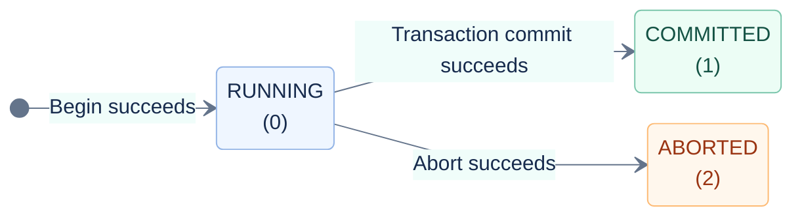
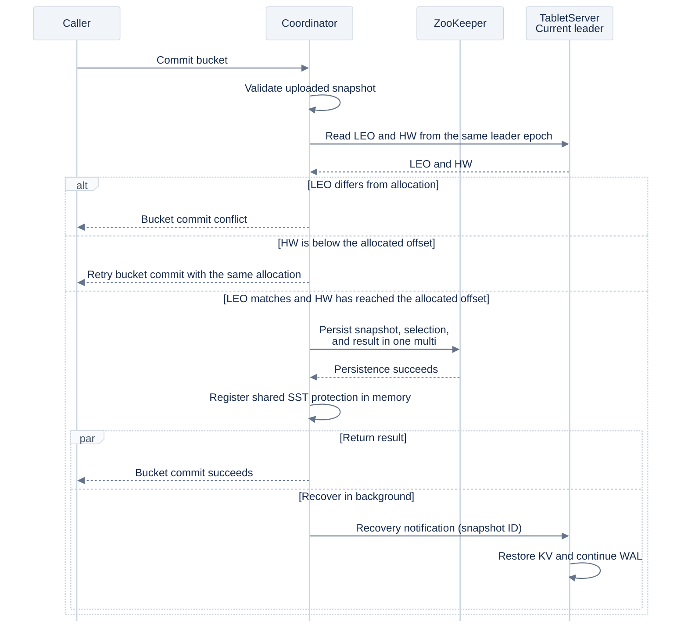
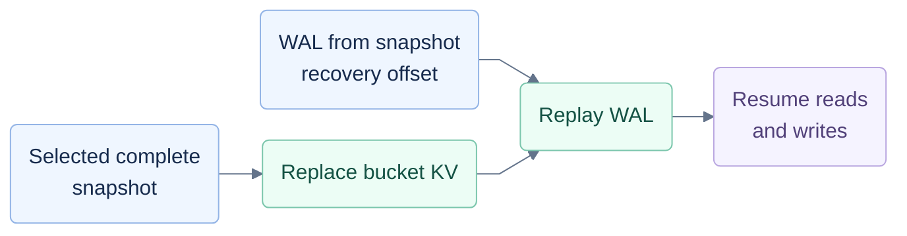

<!-- SPDX-License-Identifier: Apache-2.0 -->

# FIP-61: Snapshot-Based Bulk Loading for Primary Key Tables

| Item | Details |
| --- | --- |
| Discussion thread | To be started |
| Vote thread | To be started |
| ISSUE | To be determined |
| Release | To be determined |

## 1 Motivation

Loading a large Fluss primary key table through ordinary writes incurs the cost of processing individual records, writing and replicating the WAL, and subsequently creating snapshots. When a batch job has already computed the complete primary key state, sending these records individually through TabletServers repeats the work of the online write path.

BulkLoad allows callers to build ordinary RocksDB snapshots outside TabletServers, upload them, and have the server register and restore them. It imports complete snapshots into empty target buckets in new or existing primary key tables. A transaction covers either a non-partitioned table or one or more partitions of the same partitioned table. Buckets commit independently and become visible asynchronously.

This proposal defines a BulkLoad protocol independent of source formats and execution engines. It covers target ownership, snapshot allocation and validation, bucket commits, transaction commit and abort, progress queries, failure recovery, authorization, and persistent metadata. It completes the import workflow using existing mainline capabilities: external snapshot file formats, ordinary snapshot registration, Replica recovery, and subsequent replication.

One use case is the in-place promotion of existing Paimon tables described in [FIP-25](https://cwiki.apache.org/confluence/pages/viewpage.action?pageId=406623572). BulkLoad also supports bulk imports from other data sources.

For a batch-to-streaming handoff, the initialization job manages the source baseline:

1. Select a source snapshot and its corresponding incremental starting position, and build the target data from that snapshot.
2. Persist the association between the source position, build output, and BulkLoad ID; retries reuse this association.
3. After the BulkLoad transaction commits, start incremental processing after that source baseline.

For multiple sources, the job records each source's position and coordinates their baselines. The Fluss WAL offset describes target-side recovery, not source consumption progress; source positions remain part of the higher-level job's state rather than the BulkLoad protocol.

## 2 Public Interfaces

The following terms are used throughout this proposal:

| Term | Meaning |
| --- | --- |
| Transaction | One BulkLoad operation on a single table, potentially covering multiple partitions of that table |
| Physical target | A non-partitioned table or a physical partition of a partitioned table; referred to as a target below |
| Bucket commit | Persisting a bucket's snapshot reference and commit result, and triggering background recovery |
| Recovery snapshot reference | Selects the snapshot currently used to recover a bucket; updates use the ZooKeeper node data version for CAS |

### 2.1 Behavioral Contract

#### 2.1.1 Scope and Transaction Targets

BulkLoad primarily serves initial imports into empty target buckets. Callers should use empty targets and coordinate ordinary writes during import. The server does not check target emptiness. Before publishing a bucket, the server checks that the current leader's log end offset (LEO) matches the allocation and that its high watermark (HW) has reached that offset. These checks do not provide write isolation.

| Object | Support | Smallest target and selection scope |
| --- | --- | --- |
| New or existing non-partitioned primary key table | Supported | The entire table |
| New or existing partitioned primary key table | Non-historical partitions supported | One physical partition; a transaction may select one or more partitions of the same table |
| Tables with auto-increment columns; historical partitions | Not supported in the initial release | — |
| Merge-engine tables, including partial update and aggregation | Deferred to subsequent work | External construction must produce the complete state required by the target merge engine, which may include intermediate state beyond the output rows |
| Multi-table transactions | Not supported | A transaction belongs to exactly one table |

Begin rejects tables with auto-increment columns and historical partitions as unsupported target types. The target set and each target's bucket set are fixed when Begin succeeds. Newly created or recreated objects are not added automatically.

The following constraints apply while building snapshots:

- The caller keeps the table schema, primary key and bucket routing rules, target bucket counts, and remote directories unchanged, and builds complete snapshots using the context returned by Begin.
- The server checks the build context during allocation and bucket commit. If it has changed, the server rejects further use of that input; the caller handles the transaction and starts a new Begin.
- Caller responsibilities for concurrent DDL and deletion behavior are defined in Section 2.1.3.3.

#### 2.1.2 Completion Guarantees and Visibility

The server durably retains committed snapshots and restores each bucket asynchronously. A committed snapshot eventually becomes visible if the target still exists, no subsequent overwrite supersedes it, and the service recovers and remains available. Buckets commit and recover independently. BulkLoad does not provide atomicity across buckets or partitions, transaction isolation, or a globally consistent point-in-time snapshot. Subsequent writes, overwrites, and deletions may continue to change the data.

| Operation result | Guarantee |
| --- | --- |
| Begin succeeds | The target set is fixed, the transaction is persisted, and ownership records are established for all targets |
| Bucket snapshot allocation succeeds | The snapshot ID and WAL recovery offset are fixed for this transaction and bucket |
| Bucket commit succeeds | The snapshot reference and commit result are durable, and asynchronous recovery has been triggered |
| Bucket recovery completes | The complete snapshot has been loaded, and WAL processing continues from the recovery offset recorded in the snapshot |
| Transaction commit succeeds | All buckets of the remaining valid targets have committed; the transaction ends and releases target ownership |

After transaction commit, callers can start normal client operations. Temporary unavailability during asynchronous recovery is handled through existing client retries, as in ordinary replica recovery, migration, or leader failover. A new Begin is allowed immediately after the transaction ends. The higher-level caller coordinates recovery and visibility ordering between transactions. A later overwrite may supersede an earlier recovery request that has not started; earlier work already in flight has no ordering guarantee across transactions.

#### 2.1.3 Concurrency, Deletion, and Recreation

##### 2.1.3.1 Concurrency

| Scenario | Server behavior | Caller responsibility |
| --- | --- | --- |
| Ordinary reads and writes concurrent with BulkLoad | Reject the bucket commit if the current leader's WAL end offset differs from its allocated offset. The check does not fence later writes, and recovery is asynchronous | Coordinate ordinary reads and pause writes from allocation through bucket commit. If writes must be preserved when resuming, coordinate with bucket recovery |
| BulkLoad transactions with overlapping physical targets | Pessimistic mutual exclusion until the transaction reaches a terminal state; background recovery does not extend ownership | Wait for the previous transaction to end before Begin |
| BulkLoad transactions on disjoint partitions | May proceed in parallel | Start transactions for the selected physical targets |
| Another overwrite after the previous transaction ends but before recovery completes | Begin is allowed; recovery and visibility follow Section 2.1.2 | Coordinate recovery and visibility ordering between transactions |

##### 2.1.3.2 Writer Sessions

Before resuming ordinary writes, the caller must:

1. Stop the old writer sessions and handle any remaining work.
2. Continue with new sessions. In the Java client, recreating a writer on the same Connection still shares the WriterClient; create a new Connection before creating the new writer.

The protocol does not guarantee continuity of old writer IDs and batch sequences across an overwrite, and does not replicate additional deduplication history for old writers.

##### 2.1.3.3 Concurrent DDL, Deletion, and Recreation

Deleting an original partition removes it from the transaction's completion condition; this is referred to as withdrawing the target. A valid target is one that has not been withdrawn.

| DDL scenario | Behavior |
| --- | --- |
| Changes to table definitions or configuration that affect snapshot construction or recovery | The caller coordinates these changes to avoid conflicts with BulkLoad; BulkLoad provides no additional DDL isolation guarantee |
| Partition added | Does not join the target set fixed at Begin |
| Table dropped during a transaction | The transaction is treated as aborted; related BulkLoad information becomes unavailable and is cleaned up; data follows table deletion |
| Partition dropped during a transaction | The original physical partition is withdrawn; its remaining buckets no longer block transaction commit |
| Partition recreated with the same name | The new partition ID does not join the original transaction or receive its old input |
| Table recreated with the same name | The new table ID does not inherit the original transaction or recovery work |
| All target partitions dropped, but the table still exists | No tasks remain; transaction commit may succeed |
| Partition dropped after the transaction ends | The retained transaction result is not rewritten |
| Table dropped after the transaction ends | Related BulkLoad information becomes unavailable and is cleaned up without waiting for the result retention period |
| Other DDL | Follows existing behavior; BulkLoad adds no rejection or serialization of DDL |

Concurrent DDL follows these rules:

- Ordinary DDL retains the mainline execution model. BulkLoad adds no DDL lock and does not require DDL to wait for transactions or replica recovery to complete.
- When coordinating ALTER, the caller accounts for snapshot construction, upload, commit, and asynchronous recovery. Transaction completion does not mean that all buckets have recovered and become readable. Build-context checks during allocation and bucket commit do not replace caller coordination.

Names select and locate targets; table IDs and partition IDs bind operations to physical objects. Physical ID checks, metadata events, and maintenance propagate deletions to transactions. Recovery must not act on a new object with the same name.

Table deletion takes precedence over result retention: queries and retries using an old handle fail. `ListInProgressBulkLoads` returns table-not-found when the table does not exist; after recreation with the same name, it only queries transactions of the new table ID.

### 2.2 Coordinator RPC

BulkLoad RPCs are handled by the Coordinator. The caller first invokes Begin, then allocates, builds, uploads, and commits snapshots per bucket, and finally commits the transaction. These definitions describe server RPCs; SDKs and execution engines may wrap them. New client RPCs use version 0.

| RPC | Successful result | Retry and failure semantics |
| --- | --- | --- |
| `BeginBulkLoad` | Fixes the target set and establishes ownership; returns a handle and build context | Retry with the same specified `bulk_load_id`; the same ID cannot be reused for different targets |
| `AllocateBulkLoadBucketSnapshot` | Returns the bucket's fixed snapshot ID and WAL recovery offset | Retries return the original allocation; returns COMMITTED if the bucket has already committed |
| `CommitBulkLoadBucketSnapshot` | Persists the snapshot reference and bucket commit result, and triggers asynchronous recovery | Repeated commits return the original result without publishing another overwrite |
| `CommitBulkLoad` | Confirms all valid tasks have committed, ends the transaction, and releases target ownership | Does not wait for readability; returns incomplete if tasks remain |
| `AbortBulkLoad` | Aborts the transaction and releases target ownership | Does not roll back committed snapshots; cannot abort a COMMITTED transaction |
| `GetBulkLoadInfo` | Returns the specified transaction's status and summaries of all targets | An unknown or expired handle, or one whose original table was dropped, returns transaction-not-found |
| `ListInProgressBulkLoads` | Returns ongoing transactions for the specified table or partitions | Deduplicates transactions; returns an empty list if no valid ownership exists |

#### 2.2.1 Transaction Operations

##### 2.2.1.1 Common Types

```protobuf
message PbBulkLoadHandle {
  required int64 table_id = 1;
  required string bulk_load_id = 2;
}

message PbBulkLoadStatus {
  required PbBulkLoadHandle handle = 1;
  required int32 state = 2;
  required int64 created_time = 3;
  optional int64 finished_time = 4;
  optional string abort_message = 5;
}

message PbBulkLoadTargetInfo {
  optional int64 partition_id = 1;
  optional string partition_name = 2;
  required int32 bucket_count = 3;
  required string remote_data_dir = 4;
}
```

Common field rules:

- `PbBulkLoadStatus.state` is the transaction state; its encodings and transitions are defined in Section 3.2.1.1.
- `AllocateBulkLoadBucketSnapshotResponse.state` is the bucket state; its encodings and transitions are defined in Section 3.2.1.2.
- All time fields use Unix epoch milliseconds; `finished_time` is returned only for terminal states.
- `abort_message` is an optional caller-provided explanation, returned only when the state is ABORTED and a message was saved.

##### 2.2.1.2 Begin

```protobuf
message BeginBulkLoadRequest {
  required PbTablePath table_path = 1;
  repeated string partition_names = 2;
  optional string bulk_load_id = 3;
}

message BeginBulkLoadResponse {
  required PbBulkLoadStatus status = 1;
  required PbTableInfo table_info = 2;
  repeated PbBulkLoadTargetInfo targets = 3;
}
```

Target selection, the `bulk_load_id` format, and repeated Begin requests follow Section 3.2.2.1.

Begin returns the following build information:

| Return value | Meaning |
| --- | --- |
| `table_info` | One shared table definition; its `table_id` matches the handle |
| Partition ID and name in `targets` | The original physical partition ID and name for partition targets; both fields are omitted for non-partitioned targets |
| Bucket count and remote directory for each target | The effective build information for that target |

##### 2.2.1.3 Allocate a Bucket Snapshot

```protobuf
message AllocateBulkLoadBucketSnapshotRequest {
  required PbBulkLoadHandle handle = 1;
  optional int64 partition_id = 2;
  required int32 bucket_id = 3;
}

message AllocateBulkLoadBucketSnapshotResponse {
  required int64 snapshot_id = 1;
  required int32 state = 2;
  required int64 log_offset = 3;
}
```

The response `state` uses the bucket state encodings in Section 3.2.1.2. Request scope, allocation, and repeated requests follow Section 3.2.2.2.

##### 2.2.1.4 Commit a Bucket Snapshot

```protobuf
message CommitBulkLoadBucketSnapshotRequest {
  required PbBulkLoadHandle handle = 1;
  optional int64 partition_id = 2;
  required int32 bucket_id = 3;
}

message CommitBulkLoadBucketSnapshotResponse {}
```

##### 2.2.1.5 Commit the Transaction

```protobuf
message CommitBulkLoadRequest {
  required PbBulkLoadHandle handle = 1;
}

message CommitBulkLoadResponse {
  required PbBulkLoadStatus status = 1;
}
```

##### 2.2.1.6 Abort the Transaction

```protobuf
message AbortBulkLoadRequest {
  required PbBulkLoadHandle handle = 1;
  optional string abort_message = 2;
}

message AbortBulkLoadResponse {
  required PbBulkLoadStatus status = 1;
}
```

#### 2.2.2 Query Operations

##### 2.2.2.1 Get Transaction Information

`GetBulkLoadInfo` returns the transaction status and progress summaries for all original targets, identified by the handle.

```protobuf
message GetBulkLoadInfoRequest {
  required PbBulkLoadHandle handle = 1;
}

message PbBulkLoadTargetProgress {
  optional int64 partition_id = 1;
  required int32 bucket_count = 2;
  required int64 allocated_bucket_count = 3;
  required int64 committed_bucket_count = 4;
  required bool withdrawn = 5;
}

message GetBulkLoadInfoResponse {
  required PbBulkLoadStatus status = 1;
  repeated PbBulkLoadTargetProgress targets = 2;
}
```

| Field | Meaning |
| --- | --- |
| `partition_id` | Original physical partition ID; omitted for a non-partitioned target |
| `bucket_count` | Bucket count fixed by Begin |
| `allocated_bucket_count` | Number of buckets with allocated snapshots, including buckets that have committed |
| `committed_bucket_count` | Number of buckets that have committed |
| `withdrawn` | True when the original partition was deleted and withdrawn from the transaction; it no longer contributes to the remaining tasks |

Result scope and completion conditions:

- Targets of a partitioned table are returned in ascending order of original physical partition ID; a non-partitioned table has one target.
- Deleted original partitions remain in the result; recreated partitions do not join the original transaction. No tasks remain once all targets have been withdrawn.
- Only target summaries are returned; Begin supplies the table information and remote directories needed to build snapshots.
- Progress counts allocations and bucket commits, not completed downloads or recoveries. The caller must still commit the transaction after all valid buckets have committed.
- Query failures follow Section 2.3.2.

The query does not provide a consistent point-in-time snapshot across targets. Bucket commits, partition deletions, or transaction completion during a query may be reflected in a subsequent query.

##### 2.2.2.2 List Ongoing Transactions

```protobuf
message ListInProgressBulkLoadsRequest {
  required PbTablePath table_path = 1;
  repeated string partition_names = 2;
}

message ListInProgressBulkLoadsResponse {
  repeated PbBulkLoadStatus transactions = 1;
}
```

| Table type | `partition_names` | Query scope |
| --- | --- | --- |
| Non-partitioned table | Must be empty | The entire table |
| Partitioned table | Empty | The entire table |
| Partitioned table | Non-empty, with no duplicate names | Selected partitions; a transaction matches if it covers any selected partition |

Return rules:

- Return an error if the table or any specified partition does not exist.
- Read valid ownership records for the current physical objects and return only RUNNING transactions, excluding terminal history.
- Return each transaction once; return an empty list if no transaction is in progress.
- After discovering a handle, use `GetBulkLoadInfo` to retrieve the complete target summaries.

Listing transactions and getting information are independent queries; a transaction may end between them. If the original table still exists, `GetBulkLoadInfo` returns its retained result. Querying does not establish ownership or take over execution.

### 2.3 Authorization and Error Semantics

#### 2.3.1 Authorization

Use the table's existing ACLs without introducing partition-specific permission types. Each request is authorized against the current authenticated principal:

| RPC | Table permission |
| --- | --- |
| Begin, snapshot allocation, bucket commit, transaction commit, Abort | WRITE |
| Get transaction information, list ongoing transactions | DESCRIBE |

- A handle only identifies a transaction. Any caller with the required table permission may continue processing it; operations are not restricted to the creator.
- For handle-based operations, first confirm that the original table ID still exists, then check its permissions. A newly created table with the same name cannot substitute for it.
- The private NotifyLeaderAndIsr RPC uses existing internal authentication between the Coordinator and TabletServers.

#### 2.3.2 Error Semantics

Use the existing Fluss ErrorResponse. Specific error codes will be registered when the RPCs are implemented.

| Condition | Response semantics |
| --- | --- |
| Invalid parameters or target scope | Invalid request |
| Handle unknown or expired, or original table dropped | Transaction not found |
| Target owned by another RUNNING transaction | Target ownership conflict |
| Current leader WAL end offset differs from the bucket's allocated offset | Bucket commit fails with `BULK_LOAD_CONFLICT` before snapshot publication |
| LEO matches the allocation but the leader HW is below that offset | Bucket commit fails with a retryable error before snapshot publication |
| Buckets remain incomplete at transaction commit | Transaction incomplete |
| Request conflicts with an aborted or committed transaction state | Distinguishable transaction state errors |
| Invalid snapshot input | Snapshot input error |
| New allocation or bucket commit for a withdrawn partition | Target withdrawn; use `GetBulkLoadInfo` to determine remaining tasks |
| Insufficient permission | Existing authorization error; do not disclose the occupying transaction's details |

Retry rules:

- Retrying a committed bucket still succeeds; an uncommitted bucket cannot commit after the transaction has terminated.
- After an offset conflict, resolve the concurrent writes and obtain a fresh allocation under a new transaction. Repeating allocation in the original transaction returns the same snapshot ID and offset.
- If only the HW check fails, retry with the same allocation and uploaded snapshot once the WAL has caught up.
- Withdrawing a partition does not mean its buckets have committed.
- Metadata service failures or RPC timeouts may leave the result unknown; query or retry using the same identifiers.

### 2.4 Internal Snapshot and Recovery Protocols

Ordinary snapshot commits reuse the mainline protocol from [#5229](https://github.com/apache/fluss/pull/5229). BulkLoad adds snapshot-specific recovery notifications to version 1 of `NotifyLeaderAndIsr`.

#### 2.4.1 Ordinary Snapshot Commit

BulkLoad reuses the existing field in `CommitKvSnapshotRequest`:

```protobuf
// Added to CommitKvSnapshotRequest.
optional int64 previous_recovery_snapshot_id = 4;
```

| Field | Meaning |
| --- | --- |
| `previous_recovery_snapshot_id` | Snapshot ID selected for the KV context that produced the snapshot, captured during synchronous snapshot preparation |

The Coordinator first registers the ordinary snapshot reference and then attempts to advance the recovery selection. If the field is absent, the mainline compatibility path may create or advance the selection on a best-effort basis without comparing a previous snapshot ID. Section 3.4.2 describes the selection and role checks for requests carrying the field.

#### 2.4.2 Role and Recovery Notifications

Add these fields to the existing per-bucket `NotifyLeaderAndIsr` messages:

```protobuf
// Added to PbNotifyLeaderAndIsrReqForBucket.
optional int64 recovery_snapshot_id = 11;

// Added to PbNotifyLeaderAndIsrRespForBucket.
optional int64 recovered_snapshot_id = 4;
```

| Notification or response | Meaning |
| --- | --- |
| Request without `recovery_snapshot_id` | Ordinary role notification |
| Request with `recovery_snapshot_id` | Ask the current leader to check the selected snapshot ID and schedule asynchronous recovery if needed |
| No error; `recovered_snapshot_id` absent | Recovery is incomplete or the requested snapshot has been superseded; the Coordinator retries using the current reference |
| No error; `recovered_snapshot_id` present | The current leader's KV context corresponds to the reported snapshot ID |

A completion response ends notification retries for the bucket only when it matches both the current request and the snapshot ID selected by the current recovery reference. Notifications retain physical bucket identity, Coordinator epoch, and leader epoch checks. They do not increase the leader epoch or wait for the full download or acknowledgments from all replicas. Notification and takeover behavior is defined in Section 3.4.4. Compare snapshot IDs for equality, not allocation order. The Replica rereads the persistent reference before scheduling recovery and checks it again before reporting completion.

### 2.5 Configuration

Introduce the following two server-side options:

| Option | Default | Valid values | Meaning |
| --- | --- | --- | --- |
| `coordinator.bulkload.max-targets` | 1000 | Positive integer | Limits physical targets in one Begin and bounds the ZooKeeper multi size. A non-partitioned table counts as one target; a partitioned table counts selected partitions. |
| `coordinator.bulkload.result-retention` | 7 days | Positive duration | If the original table still exists, the minimum retention period for transaction results and bucket records after COMMITTED or ABORTED, and the valid period for idempotent retries. Dropping the table removes the corresponding records. |

## 3 Proposed Changes

### 3.1 Architecture and Import Workflow

Snapshot registration retains references to recoverable files; the recovery snapshot reference selects the current recovery source. A BulkLoad bucket commit selects the imported snapshot, after which ordinary snapshots based on the recovered KV context advance the reference.

| Component | Responsibility |
| --- | --- |
| Caller or batch job | Coordinate ordinary reads and writes, build and upload complete bucket snapshots, and commit buckets and the transaction |
| Coordinator | Manage target ownership and transaction state, validate snapshots and persist commit results, trigger recovery, and retain transaction results |
| TabletServer | Load KV from the recovery snapshot reference, resume WAL processing, and continue ordinary replication, reads, and writes |
| ZooKeeper | Store transactions, target ownership, bucket commit results, ordinary snapshot references, and recovery snapshot references |

**Figure 1. Parallel Import and Background Recovery**

```mermaid
%%{init: {"theme":"base","themeVariables":{"fontFamily":"Arial, \"PingFang SC\", \"Microsoft YaHei\", sans-serif","fontSize":"16px","primaryColor":"#EFF6FF","primaryTextColor":"#172B4D","primaryBorderColor":"#93B4E6","lineColor":"#64748B","secondaryColor":"#F0FDFA","tertiaryColor":"#FFFFFF","clusterBkg":"#F8FAFC","clusterBorder":"#CBD5E1","actorBkg":"#F1F5F9","actorBorder":"#CBD5E1","actorTextColor":"#172B4D","noteBkgColor":"#ECFDF5","noteBorderColor":"#86CDB7","noteTextColor":"#145244","labelBoxBkgColor":"#F8FAFC","labelBoxBorderColor":"#CBD5E1","labelTextColor":"#475569","signalColor":"#64748B","signalTextColor":"#172B4D"},"flowchart":{"htmlLabels":true,"curve":"linear","nodeSpacing":24,"rankSpacing":32,"padding":14},"sequence":{"mirrorActors":false,"actorMargin":34,"messageMargin":24,"noteMargin":10,"width":130,"height":50,"boxMargin":8},"themeCSS":"* { font-family: Arial, \"PingFang SC\", \"Microsoft YaHei\", sans-serif !important; }\n.node rect,.node polygon,.node path,.node circle,.cluster rect,.actor,.note,.labelBox { filter:none !important; stroke-width:1px !important; }\n.nodeLabel,.label,.messageText,.noteText { font-weight:400 !important; }\n"}}%%
flowchart LR
    Begin("Begin<br/>Fix targets and ownership") --> Allocate
    subgraph Tasks[Buckets processed in parallel]
        Allocate("Allocate snapshot") --> Build("Build and upload")
        Build --> Accept("Commit bucket")
    end
    Accept --> All("All valid tasks<br/>have committed")
    All --> Commit("Commit transaction<br/>Release ownership")
    Accept -.-> Restore
    subgraph Background[Independent background recovery]
        Restore("Restore KV<br/>Resume WAL") --> Visible("Bucket ready<br/>for reads and writes")
    end
    classDef step fill:#EFF6FF,stroke:#93B4E6,stroke-width:1px,color:#172B4D
    classDef accepted fill:#ECFDF5,stroke:#7BC6AC,stroke-width:1px,color:#145244
    classDef background fill:#F5F3FF,stroke:#B9A6E0,stroke-width:1px,color:#514079
    class Begin,Allocate,Build,All,Commit step
    class Accept accepted
    class Restore,Visible background
```



Solid arrows indicate dependencies; dashed arrows indicate asynchronous triggers. Buckets may be processed in parallel. Background recovery proceeds independently, with no ordering dependency between transaction commit and completion of individual bucket recoveries.

### 3.2 Transaction Execution

#### 3.2.1 State Transitions

Transaction state describes whether the overall import has ended. Bucket state describes whether an individual snapshot has committed. The two advance independently.

##### 3.2.1.1 Transaction State

Parenthesized numbers in Figure 2 are the protocol encodings of `PbBulkLoadStatus.state`.

**Figure 2. Transaction State Transitions**



- RUNNING: The transaction accepts snapshot allocation and bucket commits.
- COMMITTED: All buckets of targets not withdrawn from the transaction have committed; transaction commit has succeeded and target ownership is released.
- ABORTED: Explicit abort has succeeded; further input is rejected and target ownership is released. Committed snapshots are not rolled back.

A transaction moves only from RUNNING to one terminal state; terminal states cannot transition to each other. Begin fixes the target and bucket sets and establishes ownership. Terminal records are reclaimed under the result retention rules in Section 3.5.3.

##### 3.2.1.2 Bucket State

Parenthesized numbers in Figure 3 are the bucket state encodings used in snapshot allocation responses and persistent bucket records.

**Figure 3. Bucket State Transitions**

```mermaid
%%{init: {"theme":"base","themeVariables":{"fontFamily":"Arial, \"PingFang SC\", \"Microsoft YaHei\", sans-serif","fontSize":"16px","primaryColor":"#EFF6FF","primaryTextColor":"#172B4D","primaryBorderColor":"#93B4E6","lineColor":"#64748B","secondaryColor":"#F0FDFA","tertiaryColor":"#FFFFFF","clusterBkg":"#F8FAFC","clusterBorder":"#CBD5E1","actorBkg":"#F1F5F9","actorBorder":"#CBD5E1","actorTextColor":"#172B4D","noteBkgColor":"#ECFDF5","noteBorderColor":"#86CDB7","noteTextColor":"#145244","labelBoxBkgColor":"#F8FAFC","labelBoxBorderColor":"#CBD5E1","labelTextColor":"#475569","signalColor":"#64748B","signalTextColor":"#172B4D"},"flowchart":{"htmlLabels":true,"curve":"linear","nodeSpacing":24,"rankSpacing":32,"padding":14},"sequence":{"mirrorActors":false,"actorMargin":34,"messageMargin":24,"noteMargin":10,"width":130,"height":50,"boxMargin":8},"themeCSS":"* { font-family: Arial, \"PingFang SC\", \"Microsoft YaHei\", sans-serif !important; }\n.node rect,.node polygon,.node path,.node circle,.cluster rect,.actor,.note,.labelBox { filter:none !important; stroke-width:1px !important; }\n.nodeLabel,.label,.messageText,.noteText { font-weight:400 !important; }\n"}}%%
stateDiagram-v2
    direction LR
    state "Unallocated<br/>(no record)" as Unallocated
    state "ALLOCATED<br/>(0)" as Allocated
    state "COMMITTED<br/>(1)" as Committed
    Unallocated --> Allocated: Allocation succeeds
    Allocated --> Committed: Bucket commit succeeds
    classDef absent fill:#F8FAFC,stroke:#CBD5E1,color:#475569,stroke-width:1px,stroke-dasharray:4 3
    classDef allocated fill:#EFF6FF,stroke:#93B4E6,color:#172B4D,stroke-width:1px
    classDef committed fill:#ECFDF5,stroke:#7BC6AC,color:#145244,stroke-width:1px
    class Unallocated absent
    class Allocated allocated
    class Committed committed
```



Unallocated means that no allocation record exists for the bucket; it is not a persisted state. Successful allocation fixes the snapshot ID and recovery offset in an ALLOCATED record. After a successful bucket commit, COMMITTED means the snapshot reference and commit result are durable and asynchronous recovery has been triggered.

A COMMITTED bucket does not imply that the transaction has ended; a COMMITTED transaction does not imply that all buckets are readable.

##### 3.2.1.3 Deletion and Repeated Requests

These retry rules apply while the original table exists and the transaction record has not been reclaimed.

| Situation | Behavior |
| --- | --- |
| Repeated transaction commit after COMMITTED | Return the original commit result; Abort is no longer allowed |
| Repeated Abort after ABORTED | Return the original abort result and message; transaction commit is no longer allowed |
| Repeated commit for a committed bucket | Return the original successful result without publishing the snapshot again or triggering another overwrite |
| Allocate or commit an uncommitted bucket after transaction termination | Reject the request; accept no new input |
| Original physical partition dropped while RUNNING | Withdraw the target from the completion condition; the transaction remains RUNNING, without writing per-bucket skipped states |
| Original table dropped | Treat ongoing transactions as aborted; all related transaction information becomes unavailable and is cleaned up; see Section 2.1.3.3 |

#### 3.2.2 Begin and Snapshot Allocation

##### 3.2.2.1 Begin

| Table type | `partition_names` requirement |
| --- | --- |
| Non-partitioned table | Must be empty |
| Partitioned table | Must explicitly provide a non-empty list without duplicate names; an empty list does not mean the entire table |

Processing the first Begin request:

1. Resolve the table and physical partitions, check the target limit, and fix the bucket count of each target.
2. Create the transaction and all targets, and establish ownership in one bounded ZooKeeper multi. A conflict on any target fails the entire operation without retaining partial ownership. The conflict result should help authorized callers discover the occupying transaction.
3. Return the handle, table information fixed at Begin, and each target's physical ID, bucket count, and effective remote directory. Table information reuses `PbTableInfo`.

Begin does not expand bucket snapshot ID arrays, contact replicas, or wait for replica acknowledgments.

Rules for `bulk_load_id`:

| Item | Rule |
| --- | --- |
| Scope | Identifies a transaction within a physical table ID |
| Source | Specified by the caller; otherwise the server generates a UUID |
| Format | 1–128 characters; starts with an ASCII letter or digit; remaining characters may be ASCII letters, digits, hyphens, underscores, or periods, with no path separators |
| Repeated Begin | While the original table exists and the result is retained, an existing ID returns the original transaction and state without taking a new target snapshot; different target selections cannot reuse the same ID |
| Caller constraint | Never reuse an ID within the same table ID, and do not retry the original Begin beyond the result retention period |
| After reclamation | The server retains no permanent deduplication history and cannot identify arbitrarily old Begin replays |

Callers requiring reliable retries should specify `bulk_load_id`. If the ID was omitted and the response is lost, use `ListInProgressBulkLoads` to discover the transaction; another Begin is not guaranteed to identify the original transaction.

##### 3.2.2.2 Allocate a Bucket Snapshot

Request addressing rules:

- For a partitioned table, supply the physical partition ID fixed by Begin; omit it for a non-partitioned table.
- The bucket ID must be within the fixed target's range.

Processing the first allocation:

1. Allocate a snapshot ID using the existing `snapshot_seqid` of the physical bucket.
2. Read the current leader's LEO as the recovery offset. The HW check applies at bucket commit.
3. Persist the snapshot ID, recovery offset, and ALLOCATED state before returning.

| Situation | Handling |
| --- | --- |
| Repeated allocation | Return the same snapshot ID, `log_offset`, and current state |
| Bucket already committed | Return COMMITTED; the caller does not rebuild the snapshot |
| Bucket uncommitted, but transaction ended | Reject further allocation |
| Leader unavailable or metadata storage failure | Allocation may fail or its result may be unknown |
| Allocated sequence number not used | Gaps are allowed and do not correspond to file resources |

#### 3.2.3 Bucket Commit

The caller uses the allocated snapshot ID and recovery offset to upload files and ordinary `_METADATA`. Upload must finish before bucket commit; input must not change once commit begins. The server locates `_METADATA` from the fixed target, snapshot ID, and standard directory, so requests need not repeat paths or file lists.

Processing the first bucket commit:

1. Validate the snapshot's table ID, partition ID, bucket ID, snapshot ID, `log_offset`, and required file descriptors.
2. Before publication, check LEO and HW from the same leader epoch. If LEO differs from the allocated offset, return `BULK_LOAD_CONFLICT`. If LEO matches but HW is below the offset, return a retryable error. Both failures leave the bucket uncommitted. The caller coordinates writes through commit.
3. In one ZooKeeper multi, create the ordinary snapshot reference, update the recovery snapshot reference, and mark the bucket record COMMITTED.
4. Record the committed snapshot and its shared SST references in the Coordinator's in-memory snapshot store and schedule background recovery.

A bucket commits only one snapshot within a transaction. Repeated commits first read the persisted result and return success without rereading input or issuing another overwrite. Reject commits before allocation, and reject an uncommitted bucket once the transaction has ended. A deleted target is not replaced by a new object with the same name.

The bucket commit response follows successful persistence and the in-memory update needed to protect shared SST files under the existing bucket lock. Replica recovery and reclaiming superseded snapshots proceed in the background.

**Figure 4. Single-Bucket Commit Sequence**



The sequence shows the first bucket commit after upload. The response does not wait for the recovery shown in the parallel branch. Subsequent notifications confirm recovery completion as described in Section 2.4.

#### 3.2.4 Transaction Commit and Abort

| Behavior | `CommitBulkLoad` | `AbortBulkLoad` |
| --- | --- | --- |
| Preconditions | All valid tasks have committed; return incomplete immediately if any remain | Transaction is RUNNING |
| State and ownership changes | Persist COMMITTED and release target ownership | Persist ABORTED, reject further bucket commits, and release target ownership |
| Committed snapshots | Do not wait for readability; see completion guarantees in Section 2.1.2 | No rollback; recovery may continue |
| Repeated requests | Return the original commit result | Return the original abort result |
| Terminal state conflict | ABORTED cannot become COMMITTED | COMMITTED cannot become ABORTED |

Rules for `abort_message`:

- The caller may provide a brief diagnostic explanation. It does not affect state transitions and does not contain a stack trace.
- The first successful Abort persists the explanation and ABORTED state in the same atomic update; omit the field if no explanation was supplied.
- Queries and repeated Abort return the original explanation. Retries neither overwrite it nor fill in a message omitted by the first Abort.

Concurrent operation rules:

| Concurrent operations | Resolution |
| --- | --- |
| Abort and bucket commit | Persistence order of the atomic metadata operations determines whether the bucket commit takes effect |
| Abort and transaction commit | The first persisted terminal state takes effect |

Transaction commit checks completion against the fixed bucket counts with bounded concurrency, without loading every bucket at once. Bucket commit states advance monotonically and deleted physical partitions do not rejoin, so each bucket commit need not contend on a global completion counter. Version checks link completion verification to the terminal state update and prevent late operations from committing new snapshots after Abort.

### 3.3 Persistent Metadata

BulkLoad persists information in two locations:

- **ZooKeeper**: Transaction progress, target ownership, and snapshot references required for recovery. Layout and record definitions are in Section 3.3.1.
- **Remote storage**: `_METADATA` and snapshot files such as SSTs. Directories and file formats are in Section 3.3.2.

Progress queries read transaction records. Recovery first reads the physical bucket's recovery snapshot reference, then uses the selected snapshot ID to obtain `metadata_path` from its ordinary snapshot reference and load remote files. Reclaiming transaction results does not change the recovery snapshot reference.

#### 3.3.1 ZooKeeper Metadata

##### 3.3.1.1 Node Layout

`$ZK_ROOT` denotes the configured ZooKeeper root path. Only BulkLoad-related nodes are shown below.

- `[New]` marks a path structure or record introduced by this proposal. A marker on a subtree root applies to the whole subtree. All new nodes are persistent.
- `[Existing]` marks a mainline path structure or record format reused by BulkLoad.
- Section numbers in the tree point to record definitions. Intermediate nodes without a stated purpose only organize paths.

```text
$ZK_ROOT
├── bulk_load/                                      [New] Transaction metadata subtree
│   └── tables/{tableId}/
│       ├── transactions/{bulkloadId}                Transaction record → 3.3.1.2
│       │   └── targets/
│       │       ├── table/                          Non-partitioned target record → 3.3.1.3
│       │       │   └── buckets/{bucketId}           Bucket record → 3.3.1.4
│       │       └── partitions/{partitionId}/       Partition target record → 3.3.1.3
│       │           └── buckets/{bucketId}           Bucket record → 3.3.1.4
│       └── owners/
│           ├── table                               Non-partitioned target ownership → 3.3.1.5
│           └── partitions/{partitionId}            Partition target ownership → 3.3.1.5
└── tabletservers/                                  [Existing]
    ├── tables/{tableId}/buckets/{bucketId}/          [Existing] Non-partitioned table bucket
    │   ├── snapshot_seqid                          [Existing] Snapshot ID sequence
    │   ├── recovery_snapshot                       [Existing] Recovery snapshot reference → 3.3.1.6
    │   └── snapshots/{snapshotId}                   [Existing] Ordinary snapshot reference → 3.3.1.7
    └── partitions/{partitionId}/buckets/{bucketId}/ [Existing] Partitioned table bucket
        ├── snapshot_seqid                          [Existing] Snapshot ID sequence
        ├── recovery_snapshot                       [Existing] Recovery snapshot reference → 3.3.1.6
        └── snapshots/{snapshotId}                   [Existing] Ordinary snapshot reference → 3.3.1.7
```

Non-partitioned transactions use only `targets/table` and `owners/table`; partitioned transactions use nodes for the selected physical partitions. Ordinary table and partition registration and LeaderAndIsr retain their mainline formats.

###### 3.3.1.1.1 Transaction Progress and Replica Recovery

A transaction's bucket record retains the fixed result of that import. The recovery snapshot reference under the physical bucket selects the current recovery source. Their lifecycles differ:

| Record | Purpose | After a subsequent snapshot commit | Cleanup |
| --- | --- | --- | --- |
| Bucket record under a transaction | Progress queries and idempotent retries | Retains the original transaction's snapshot ID, recovery offset, and commit state | When transaction result retention expires, or the table is deleted |
| Recovery snapshot reference under a physical bucket | Select a recovery source for current and subsequent leaders | May be replaced by another import or advanced by an ordinary snapshot based on the current KV context | When the bucket or table is deleted |

For example, transaction A commits snapshot 17, then ordinary snapshot 18 advances the recovery reference. A's bucket record still returns snapshot 17; reclaiming A's transaction result does not affect recovery from snapshot 18.

Ownership records provide mutual exclusion for overlapping targets and become logically invalid as soon as the transaction becomes terminal. Ordinary snapshot references serve existing snapshot management; their retention and cleanup are independent of transaction results.

The following sections define records using the tree's numbering. New records use version 1 JSON, and timestamps use Unix epoch milliseconds. Physical IDs and `bulk_load_id` for transactions and tasks are read from paths; ownership records store the transaction ID they reference.

##### 3.3.1.2 Transaction Record

Path: `$ZK_ROOT/bulk_load/tables/{tableId}/transactions/{bulkloadId}`.

This node stores the state and shared build context for the entire import:

| Field | Type | Meaning |
| --- | --- | --- |
| `version` | int32 | Format version; 1 |
| `state` | int32 | `0=RUNNING`, `1=COMMITTED`, `2=ABORTED`; transitions are defined in Section 3.2.1.1 |
| `table_path` | object | Strings `database_name` and `table_name`, for display and locating the original table |
| `table_info` | object | Shared build context fixed at Begin |
| `created_time` | int64 | Transaction creation time |
| `finished_time` | int64, optional | Time the transaction became terminal; omitted while RUNNING |
| `abort_message` | string, optional | Explanation supplied by the first Abort; stored only for ABORTED |

Mapping between `table_info` and the RPC `PbTableInfo`:

| Field | Persistence and RPC representation |
| --- | --- |
| `table_id` | Populated in `PbTableInfo` from the transaction path |
| `schema_id`, `created_time`, `modified_time` | Stored in `table_info` and mapped to RPC fields by name |
| `table_json` | Stored as a `TableDescriptorJsonSerde` JSON object with the existing schema encoding; encoded as UTF-8 bytes in RPC responses |
| `remote_data_dir`, `bucket_count_epoch` | Stored in `table_info` when present and mapped to RPC fields by name |

The transaction record stores no target list, bucket array, or progress counter. The schema and table definition are stored once; target-specific differences are stored in target nodes.

##### 3.3.1.3 Target Record

| Target type | Target record path |
| --- | --- |
| Non-partitioned table | `$ZK_ROOT/bulk_load/tables/{tableId}/transactions/{bulkloadId}/targets/table` |
| Physical partition of a partitioned table | `$ZK_ROOT/bulk_load/tables/{tableId}/transactions/{bulkloadId}/targets/partitions/{partitionId}` |

A target node stores the effective bucket count and remote directory fixed at Begin, and whether the target has been withdrawn. A partition target also stores its name:

```json
{
  "version": 1,
  "partition_name": "p1",
  "bucket_count": 128,
  "remote_data_dir": "s3://warehouse/fluss",
  "withdrawn": false
}
```

| Field | Type | Meaning |
| --- | --- | --- |
| `version` | int32 | Format version; 1 |
| `partition_name` | string, optional | Original partition name; omitted for a non-partitioned target |
| `bucket_count` | int32 | Effective bucket count fixed at Begin |
| `remote_data_dir` | string | The physical target's effective directory; queries do not reapply current configuration |
| `withdrawn` | bool | Whether the target has been withdrawn; initially false |

Target build information corresponds to `PbBulkLoadTargetInfo` returned by Begin. The number of target records is bounded by the per-transaction target limit.

Rules for updating `withdrawn`:

- While RUNNING, set it to true after confirming deletion of the original partition, with transaction and target version checks.
- After the transaction ends, retain its task scope at completion; later partition deletion does not rewrite the record.

##### 3.3.1.4 Bucket Record

| Target type | Bucket record path |
| --- | --- |
| Non-partitioned table | `$ZK_ROOT/bulk_load/tables/{tableId}/transactions/{bulkloadId}/targets/table/buckets/{bucketId}` |
| Physical partition of a partitioned table | `$ZK_ROOT/bulk_load/tables/{tableId}/transactions/{bulkloadId}/targets/partitions/{partitionId}/buckets/{bucketId}` |

A bucket record is created on its first snapshot allocation and stores the fixed snapshot ID, recovery offset, and task state. The following example shows a committed bucket:

```json
{
  "version": 1,
  "snapshot_id": 17,
  "log_offset": 1000,
  "state": 1
}
```

| Field | Type | Meaning |
| --- | --- | --- |
| `version` | int32 | Format version; 1 |
| `snapshot_id` | int64 | Snapshot ID fixed by the first allocation |
| `log_offset` | int64 | WAL recovery offset fixed by the first allocation |
| `state` | int32 | ALLOCATED is 0; COMMITTED is 1. Bucket commit updates the state; repeated requests read the original result |

The record is reclaimed with the transaction result. Unallocated buckets have no record.

##### 3.3.1.5 Ownership Record

| Target type | Ownership record path |
| --- | --- |
| Non-partitioned table | `$ZK_ROOT/bulk_load/tables/{tableId}/owners/table` |
| Physical partition of a partitioned table | `$ZK_ROOT/bulk_load/tables/{tableId}/owners/partitions/{partitionId}` |

A physical target has at most one ownership record pointing to the transaction that currently owns it:

```json
{
  "version": 1,
  "bulk_load_id": "load-20261112-001"
}
```

| Field | Type | Meaning |
| --- | --- | --- |
| `version` | int32 | Format version; 1 |
| `bulk_load_id` | string | ID of the transaction currently owning the target |

Ownership record lifecycle:

- Valid while it references a RUNNING transaction.
- Logically invalid immediately after the transaction becomes terminal; the next Begin may atomically replace it without waiting for background deletion.
- Cleanup and replacement check the record version and transaction ownership, so they do not delete a later transaction's ownership.

##### 3.3.1.6 Recovery Snapshot Reference

| Target type | Recovery snapshot reference path |
| --- | --- |
| Non-partitioned table | `$ZK_ROOT/tabletservers/tables/{tableId}/buckets/{bucketId}/recovery_snapshot` |
| Physical partition of a partitioned table | `$ZK_ROOT/tabletservers/partitions/{partitionId}/buckets/{bucketId}/recovery_snapshot` |

Each physical bucket using this capability retains one reference:

```json
{
  "version": 1,
  "snapshot_id": 17
}
```

| Field | Type | Meaning |
| --- | --- | --- |
| `version` | int32 | JSON format version; 1 |
| `snapshot_id` | int64 | Selected recovery snapshot ID, identifying an ordinary snapshot reference from Section 3.3.1.7 |

Concurrent updates use the node's ZK data version, which is distinct from the JSON format version. The node does not duplicate the WAL offset or file path. It outlives transaction results, is not modified by recovery completion responses, and is removed with the physical bucket. Update rules are defined in Section 3.4.2.

##### 3.3.1.7 Ordinary Snapshot Reference

Committed snapshots use the ordinary snapshot references already present in mainline.

| Target type | Ordinary snapshot reference path |
| --- | --- |
| Non-partitioned table | `$ZK_ROOT/tabletservers/tables/{tableId}/buckets/{bucketId}/snapshots/{snapshotId}` |
| Physical partition of a partitioned table | `$ZK_ROOT/tabletservers/partitions/{partitionId}/buckets/{bucketId}/snapshots/{snapshotId}` |

The node uses the existing `BucketSnapshot` record:

```json
{
  "version": 1,
  "snapshot_id": 17,
  "log_offset": 1000,
  "metadata_path": "s3://warehouse/fluss/kv/db/orders-100/p1-p201/0/snap-17/_METADATA"
}
```

| Field | Type | Meaning |
| --- | --- | --- |
| `version` | int32 | Format version; 1 |
| `snapshot_id` | int64 | ID of this snapshot |
| `log_offset` | int64 | WAL recovery offset of this snapshot |
| `metadata_path` | string | Path to `_METADATA` in the remote snapshot directory |

At BulkLoad bucket commit, the snapshot ID and recovery offset match the transaction's bucket record written in the same atomic operation, and the recovery snapshot reference selects that snapshot ID. Subsequent snapshots may advance the recovery reference without changing the transaction result. Files follow ordinary snapshot retention; protection of the current recovery reference is defined in Section 3.5.3.

#### 3.3.2 Remote Snapshot Files

##### 3.3.2.1 Directory Layout

Remote files reuse the mainline KV snapshot directories for snapshot metadata and data files.

| Target type | Snapshot directory |
| --- | --- |
| Non-partitioned table | `{remote_data_dir}/kv/{database}/{table}-{tableId}/{bucketId}/snap-{snapshotId}/` |
| Partitioned table | `{remote_data_dir}/kv/{database}/{table}-{tableId}/{partition}-p{partitionId}/{bucketId}/snap-{snapshotId}/` |

Each snapshot directory has the following contents. File names and hierarchy are described by the file list in `_METADATA`.

```text
snap-{snapshotId}/
├── _METADATA                Snapshot metadata; see 3.3.2.2
└── Snapshot files           SSTs and other files referenced by _METADATA
```

Once committed, snapshots are managed through ordinary snapshot references and retention, and are removed with table data on deletion.

##### 3.3.2.2 Snapshot Metadata File

Path: `_METADATA` under the snapshot directory defined in Section 3.3.2.1.

`_METADATA` uses the ordinary version 1 JSON format of `KvSnapshotFileMetadataJsonSerde`, storing physical IDs, the recovery offset, row count, and file list. This example shows one private file:

```json
{
  "version": 1,
  "table_id": 100,
  "partition_id": 201,
  "bucket_id": 0,
  "snapshot_id": 17,
  "snapshot_location": "s3://warehouse/fluss/kv/db/orders-100/p1-p201/0/snap-17",
  "kv_snapshot_handle": {
    "shared_file_handles": [],
    "private_file_handles": [
      {
        "kv_file_handle": {
          "path": "s3://warehouse/fluss/kv/db/orders-100/p1-p201/0/snap-17/000001.sst",
          "size": 1024
        },
        "local_path": "000001.sst"
      }
    ],
    "snapshot_incremental_size": 1024
  },
  "log_offset": 1000,
  "row_count": 10
}
```

The file list points to the actual snapshot files; ZooKeeper does not store their contents. Non-partitioned snapshots omit `partition_id`. Row counts, file descriptors, and other fields retain the mainline format, without introducing a shared digest across files or targets.

#### 3.3.3 Atomic Update Boundaries

A bucket commit registers the ordinary snapshot reference, updates the physical bucket's recovery snapshot reference, and marks the transaction's bucket as COMMITTED in one ZooKeeper multi. The commit result and the information required for replica recovery are persisted together, so a successful commit cannot be recorded without its recovery information.

Operations coordinate through ZooKeeper version checks on the transaction, target, and related records:

| Operation | Checks | Records written |
| --- | --- | --- |
| Begin | Physical target IDs, target ownership, and the state of the transaction referenced by any previous ownership record | Atomically create the transaction and all target records, and establish or replace ownership records |
| Allocate snapshot | Transaction still RUNNING, target valid, bucket unallocated | Create the transaction's bucket record and fix the allocation result |
| Bucket commit | Before publication, the current leader's LEO matches the allocation and its HW has reached that offset. The multi checks the transaction and allocation versions, physical target, and recovery reference version or first creation | Update the bucket record and recovery snapshot reference, and create the ordinary snapshot reference in the same multi |
| Ordinary snapshot advancement | Reuse the mainline previous-snapshot check when applicable, the recovery reference version, and the leader epoch check | Register the ordinary snapshot first, then advance the selection with CAS |
| Ordinary snapshot reference reclamation | The Coordinator's bucket snapshot store protects the selected snapshot and applies existing lease and shared-file rules | Prune eligible references and reclaim their files using the existing retention mechanism |
| Transaction commit | All valid tasks complete; transaction version unchanged | Write COMMITTED to the transaction record; ownership becomes logically invalid with the terminal state |
| Abort | Transaction still RUNNING; transaction version unchanged | Write ABORTED and the optional explanation; committed bucket snapshots are not rolled back |
| Withdraw partition | Original target's physical ID; transaction and target versions | Set the target's `withdrawn` to true; do not modify after transaction termination |
| Clean up or replace ownership | Ownership record version, owning transaction, and its terminal state | Delete or replace only records still belonging to the expected transaction |

When transaction commit races with Abort, only the first persisted terminal state succeeds. Physical IDs and metadata versions verify target validity; ordinary DDL retains the mainline execution model.

### 3.4 Snapshot Recovery and WAL Continuation

#### 3.4.1 Overwrite Recovery

BulkLoad establishes the overwritten KV state of each bucket in two steps:

1. Load a complete snapshot to replace the original KV data.
2. Replay WAL from the recovery offset recorded in that snapshot to process subsequent changes.

Old WAL before the recovery offset is not applied to the new KV state. Existing log offsets are not renumbered; log reads and retention continue to use mainline mechanisms.

**Figure 5. Complete Snapshot and Subsequent WAL Form the Overwritten KV State**



#### 3.4.2 Selecting and Advancing the Recovery Snapshot

When a recovery snapshot reference exists, recovery reads only the ordinary snapshot reference it selects and resumes WAL processing from that snapshot's `log_offset`. Snapshot IDs describe allocation order and offsets describe log positions; neither replaces the explicit recovery selection. Buckets without the reference retain mainline recovery behavior.

Ordinary and imported snapshots share the same WAL retention rule: the current recovery snapshot's offset defines the boundary that cleanup must not cross. A replacement recovery source must become durable before the cleanup boundary advances. Snapshot registration alone does not authorize further WAL cleanup.

| Update operation | Conditions and persistence |
| --- | --- |
| BulkLoad explicitly selects a snapshot | Atomically register the newly allocated snapshot, create or update the recovery reference, and persist the bucket commit result. Check the ZK version when updating an existing reference; on conflict, reread and retry the metadata update without rebuilding the snapshot |
| An ordinary snapshot advances the reference | Register the ordinary snapshot first. When a previous snapshot ID is supplied and a selection already exists, require an identity match. The selection update uses the read ZK version and the mainline leader epoch check. A rejected update leaves the new snapshot registered without selecting it |
| An ordinary snapshot commit omits the previous snapshot ID | Preserve the mainline compatibility path. After registration the Coordinator may create or advance the selection on a best-effort basis, without a previous-snapshot identity comparison |

KV contexts track the selected snapshot as follows:

1. Loading the selected snapshot binds its ID to that KV context. An asynchronous snapshot captures this ID during synchronous preparation; it cannot substitute the latest selection at commit time.
2. After an ordinary snapshot advances the reference, its original KV context accepts the submitted snapshot ID without reloading data. A late result must not update a replacement KV context. Lost responses are handled as described in Section 3.5.1.
3. The reference's ZK version changes only when a snapshot is selected or the reference advances. Recovery completion responses do not modify the node.

The following interleaving illustrates an ordinary snapshot overlapping an overwrite:

| Step | Selected or expected snapshot ID | Result |
| --- | --- | --- |
| The old KV context starts a periodic snapshot | Captures selected snapshot 16 | Build and upload proceed in the background |
| BulkLoad selects snapshot 17 | Selection changes from 16 to 17 | Subsequent recovery uses snapshot 17 |
| The old periodic snapshot commits late | Still expects snapshot 16 | Cannot replace the selection of snapshot 17 |
| After recovering snapshot 17, the new KV context produces ordinary snapshot 18 | Expects snapshot 17 | Successful commit selects snapshot 18 and updates the original KV context to 18 |

When a selection already exists, a commit carrying a different previous snapshot ID cannot advance it. The selection update does not impose a separate strictly increasing offset check. Each advancement selects a newly allocated snapshot ID. Snapshot file formats and the meaning of WAL offsets remain unchanged.

#### 3.4.3 Local Log Continuation

BulkLoad uses ordinary snapshot recovery. The selected snapshot provides the KV state before its recovery offset. The replica resumes WAL replay from that offset using the existing log recovery rules.

| Local log state | Handling |
| --- | --- |
| Local LEO has reached or passed the recovery offset | Preserve the existing WAL and replay from the recovery offset |
| Local LEO is behind the recovery offset and a Remote Log manifest exists | Use the existing Remote Log recovery path |
| Local LEO and HW are both zero, no Remote Log manifest exists, and the recovery offset is positive | Initialize the empty local log at the recovery offset after loading the snapshot |
| Local WAL is behind the recovery offset, the log is ineligible for empty-log initialization, and no Remote Log manifest exists | Fail recovery and preserve the local WAL |

The bucket commit HW check lets BulkLoad rely on the ordinary replication and recovery rules. The Replica reports recovery completion after initializing KV state, row counts, and ordinary background tasks.

#### 3.4.4 Recovery Notifications and Leader Changes

After an explicit snapshot selection, the Coordinator notifies the leader using the snapshot ID selected by the current recovery reference. Notifications only schedule or query background work; they do not wait for downloads. Each Replica runs at most one KV recovery task at a time, and duplicate notifications reuse in-flight work or its completed result.

| Scenario | Behavior |
| --- | --- |
| Current leader | Check the local KV context against the currently selected snapshot ID; load the selected snapshot if needed and report its ID after KV, WAL, and background task initialization completes |
| An ordinary snapshot advances the reference | The leader that produced it updates the selected snapshot ID of its original KV context without reloading KV |
| Follower | Retain ordinary WAL replication without a serving KV store; no Begin or bucket commit acknowledgment |
| New leader | Select the snapshot from the persistent recovery reference and establish the KV context without relying on transaction records |
| Coordinator takeover | Reconstruct notifications from persistent recovery references for known physical buckets and check selected snapshot IDs with current leaders, without relying on the previous in-memory retry queue |

Every retry reads the current reference. An outdated request does not require recovery to an old selection, and an old response cannot end retries for a different snapshot; confirmation conditions are defined in Section 2.4.2. Notification progress resides in in-memory tasks; the recovery reference stores no completion marker.

When the leader retains old logs, lagging followers catch up normally. If the local log start has advanced, existing offset-out-of-range handling applies and Remote Log remains readable through mainline mechanisms. Neither transaction completion nor result reclamation removes the recovery reference.

#### 3.4.5 Log Subscriptions and Changelog

Snapshot overwrite directly replaces KV state. It does not append WAL or generate INSERT, UPDATE, or DELETE events for each snapshot row, nor does it generate an additional overwrite marker. Subsequent ordinary writes continue producing records according to the table's changelog configuration.

Existing log subscriptions continue reading by offset within the log range retained by mainline. If logs are unavailable, existing offset-out-of-range behavior applies. This readable range is independent of the new KV state's recovery offset.

A downstream subscriber to WAL or changelog cannot obtain the imported baseline from that subscription alone. Snapshot reads and subsequent log consumption provide the complete initial state and later changes.

Lake tiering uses the following paths:

| Bucket condition | Tiering behavior |
| --- | --- |
| No existing lake progress, with a KV snapshot available | Read the KV snapshot as the initial lake baseline, record its WAL offset, then continue from that offset |
| Imported KV snapshot with a WAL end offset of zero | Schedule the initial snapshot read even though no WAL records have been written; the mainline shortcut that skips zero-offset buckets must not hide imported data |
| Existing lake progress | Continue consuming WAL from the recorded position; do not automatically reread an overwritten KV snapshot |

The snapshot path establishes an initial baseline; it does not provide a general overwrite mechanism for existing lake tables.

### 3.5 Lifecycle and Failure Handling

#### 3.5.1 Retries and Failure Recovery

After an RPC timeout, query or retry using the original handle; retry Begin with the original `bulk_load_id`. Retain uploaded files while the result is unknown. Idempotent retries apply while the original table exists and the result is retained. The original commit cannot continue once its record is reclaimed or its table is dropped.

On takeover, the Coordinator reconstructs notifications as described in Section 3.4.4. Cache reconstruction loads the snapshot selected by the current recovery reference and registers its shared files before retention and eviction. If the snapshot is absent from the list, read it by snapshot ID rather than falling back to the largest snapshot ID.

Recovery failures are handled as follows:

| Failure stage | Handling |
| --- | --- |
| Bucket commit durable, Coordinator cache registration fails | Keep persistent references and input files, reload the snapshot handle, and finish shared-file registration and retention; deduplicate registration by snapshot ID without rewriting the snapshot reference or `_METADATA` |
| Ordinary snapshot commit response is lost; the reference still selects the submitted snapshot | Confirm the update, advance only the original KV context, and protect registered files |
| Response is lost and the above conditions cannot be confirmed | Check or recover from the current reference without binding its selected snapshot ID to old KV; do not delete registered files because a response was lost |
| Download or KV initialization fails | Release resources for the attempt, then retry |
| I/O error during log tail initialization, flush, or checkpoint | Stop using the potentially partially modified log object; use the existing storage failure path and reload on restart |

#### 3.5.2 Abandoned Transactions

Losing contact with the caller does not automatically abort a RUNNING transaction. Operators or other callers with WRITE permission discover it through `ListInProgressBulkLoads` and explicitly Abort using its handle. Stop the original job and upload tasks before cleaning up build-side input.

#### 3.5.3 Deletion and Resource Reclamation

Cleanup rules when a table is dropped:

- Deletion notifications trigger background removal of transaction, target, bucket, and ownership records under `$ZK_ROOT/bulk_load/tables/{tableId}`, using the original table ID.
- DROP does not wait for individual records to be deleted or for recovery to finish.
- Coordinator takeover and metadata cleanup check for remnants of deleted tables and continue cleanup after failures.
- Recovery snapshot references, ordinary snapshot references, and data files under physical buckets follow the existing table deletion workflow.

| Resource | Ownership and reclamation |
| --- | --- |
| Build-side local directories and upload streams | The caller closes them and cleans up after success, failure, or cancellation |
| Remote input not yet committed | The caller cleans it up only after upload tasks have stopped and the bucket commit result is confirmed; a timeout does not imply failure to commit |
| Committed snapshots | Managed by ordinary snapshot references and retention; transaction completion does not delete files |
| Snapshot selected by the current reference | Included in existing in-use snapshot protection and shared-file registration; transaction result reclamation does not affect it |
| Old source superseded by a later overwrite | Reclaimed under ordinary retention; an old download may fail, exit, and process the current reference |
| TabletServer download and KV resources | Released on failure, close, or replica deletion; partial local data must be cleaned up and retries must not accumulate directories |
| Ownership records | Logically invalid immediately at a terminal state; background cleanup deletes only records still owned by the original transaction |
| Transaction results and bucket records | Reclaimed after the retention period while the original table exists; removed by original table ID on table deletion without waiting for retention |
| Recovery snapshot reference | Retained for the physical bucket lifecycle and updated by explicit selection or ordinary snapshot advancement; not reclaimed with transaction results |

Ordinary and imported snapshots share the mainline retention mechanism from #5229. The Coordinator tracks the selected snapshot in the bucket snapshot store and uses the same bucket lock to serialize selection with retention. Retention skips the selected snapshot and applies existing lease and shared-file protection to eligible snapshots. On takeover, the bucket store recovers its selection from the durable reference.

A superseded snapshot has no separate long-lived lease. If an old recovery source has been reclaimed, release attempt resources and retry from the current reference; missing files do not indicate completed recovery.

Local files, handles, and background tasks must have explicit close and failure cleanup paths. Remote fault remnants are exceptional; producing orphan files on every retry is not an acceptable normal workflow.

### 3.6 Performance and Execution Threads

Begin work scales linearly with the target count; allocation, bucket commit, and recovery proceed per bucket.

| Operation | Main cost | Execution thread | Concurrency and memory constraints |
| --- | --- | --- | --- |
| Begin | Target and ownership records scale linearly with targets; one bounded ZooKeeper multi | ZooKeeper operations on worker threads | Target count limited by configuration; no bucket-level preallocation or replica wait |
| Allocate bucket snapshot | Read the current leader's log position and persist the allocation | Network and ZooKeeper operations on worker threads | Allocate on demand |
| Bucket commit | Validate uploaded metadata and files, check leader LEO and HW, and persist the bucket result | File, network, and ZooKeeper operations on worker threads | Validation runs outside the bucket publication lock. No global completion counter |
| Ordinary snapshot advancement | Reuse the mainline snapshot registration followed by a conditional selection update | Worker threads | No global lock or replica wait |
| Progress query | Aggregate bucket states on demand | Worker threads | Bounded concurrent reads; response size scales with targets, aggregation work with buckets |
| Snapshot cache and retention | Register validated shared files in memory and apply retention in the background | Worker threads | Protect the selected snapshot under the existing bucket lock |
| Replica recovery | Download and load the snapshot; initialize the log tail, flush, and checkpoint if needed | Worker threads | Existing bucket and log locks; no global wait |

The Coordinator event thread only schedules work and applies results; network, file, and ZooKeeper operations run elsewhere. Large transactions do not require loading all bucket file descriptors into Coordinator memory at once.

Persistent record counts:

| Record | Count |
| --- | --- |
| Transaction record | One per transaction |
| Target and ownership records | Linear in the target count |
| Bucket allocation and commit records | Linear in the number of participating buckets |
| Recovery snapshot reference | One per physical bucket using this capability |

### 3.7 Correctness and Validation

Core properties to check:

- RUNNING transactions cannot own the same physical target concurrently; a new Begin is allowed immediately after a terminal state.
- The target and bucket sets fixed by Begin do not change on recreation with the same name.
- A bucket's first commit result in a transaction is immutable; repeated RPCs do not republish an overwrite.
- Abort rejects new bucket commits; committed snapshots still require recovery while their targets exist.
- Transaction commit requires only that all valid tasks have committed, not synchronous visibility.
- Current pending recovery input has a persistent reference and file protection; old completion responses do not clear new work.
- Overwrite recovery does not replay WAL before the import recovery offset; retries do not remove newer WAL already present after that offset.
- An ordinary commit carrying a previous snapshot ID cannot replace a different current selection. The snapshot store protects the selected reference from reclamation.
- Local failure, cancellation, and repeated retries do not accumulate files, streams, handles, or tasks without an owner.

The models check the following scopes separately:

| Model | Scope and result |
| --- | --- |
| Transaction state | Target exclusion, bucket commit persistence, and terminal states |
| Recovery reference | One bucket with an initialized reference, two asynchronous ordinary snapshot tasks carrying previous snapshot IDs, three explicit selections, one restart, and concurrent reclamation. This model checks reference protection and rejection of stale tasks in that scope |
| Notifications and takeover | Two reference updates and one Coordinator crash; takeover reconstruction and snapshot-ID-matched responses eventually recover a stable reference |
| Local WAL | Lagging local logs, retained existing WAL, lagging HW checkpoints, and interrupted recovery; check recovery positions and log retention |
| Liveness assumptions | Failures stop, input remains available, and metadata and recovery tasks are fairly scheduled |

These models are checked separately and do not replace end-to-end implementation validation. Implementation tests also cover actual files and shared SST reclamation, role changes, queries, and permissions. Test coverage is specified in Section 5.

## 4 Compatibility, Deprecation, and Migration Plan

Compatibility is assessed against current Fluss mainline.

| Interface or format | Compatibility |
| --- | --- |
| New client RPCs | Version 0 |
| Internal snapshot and recovery RPCs | Reuse mainline `CommitKvSnapshot`. Recovery notifications carrying a snapshot ID require `NotifyLeaderAndIsr` version 1 |
| Ordinary KV snapshots | Reuse existing encoding and snapshot ID sequences without changing the file format |
| ZooKeeper metadata | Transaction records and generic recovery snapshot references are independent and addressed by physical IDs; existing ordinary snapshot reference formats are unchanged |
| Existing public APIs and table data | No existing APIs are deprecated and enabling the protocol requires no migration of existing table data |

Enablement and upgrade requirements:

- Upgrade all Coordinators and TabletServers to versions supporting these protocols and recovery snapshot references before enabling BulkLoad.
- A BulkLoad bucket commit atomically registers its snapshot and creates or updates the same recovery reference that ordinary snapshots use.
- The ordinary snapshot RPC retains its mainline compatibility behavior. A notification carrying a recovery snapshot ID cannot fall back to version 0, and an unsupported response does not confirm recovery.

Downgrade restrictions:

- Active transactions and buckets retaining recovery snapshot references cannot be taken over by older versions that do not understand those records.
- Operational upgrade procedures must enforce this requirement; no additional session or admission protocol is introduced.
- Reclaiming transaction results does not delete recovery snapshot references; transaction completion alone is not sufficient to determine that downgrade is safe.

## 5 Test Plan

System tests cover the following categories with Remote Log both enabled and disabled.

### 5.1 Transactions and Idempotency

- Existing multi-bucket tables and multi-partition transactions, including point lookups, updates, deletes, and subsequent ordinary snapshots.
- Races between bucket commit and Abort, lost responses, and consecutive overwrites.
- A write after allocation changes the WAL end offset and causes the bucket commit to fail without publishing its snapshot.
- With LEO still matching the allocation, a lagging HW prevents publication. Once HW reaches the allocated offset, retry with the same allocation and verify that a newly elected replica can use ordinary snapshot recovery.
- Persistence and queries of abort explanations; repeated Abort neither overwrites nor fills in the first explanation.

### 5.2 Deletion and Lifecycle

- Partial partition deletion and recreation with the same name; newly added partitions do not join an existing transaction.
- Old handles cannot query or continue after table deletion; transaction record cleanup, cleanup resumed on Coordinator takeover, and isolation from a recreated table with the same name.

### 5.3 Recovery and Replication

- A first selection racing with an ordinary snapshot carrying a previous snapshot ID; verify that a stale previous ID cannot replace the selection.
- Coordinator takeover after reference persistence but before notification enqueue, leader failures, WAL continuation around the recovery offset, and crash recovery at each stage.
- Late periodic snapshots, ordinary snapshot advancement using the selected snapshot ID captured from the KV context, lost commit responses, and late callbacks; no binding of a new selection to old KV.
- Explicit selection racing with ordinary snapshot commit and GC; the current reference never selects a reclaimed snapshot.
- Writes from new writer sessions, changelog behavior, and ordinary snapshot reclamation.

### 5.4 Queries and Authorization

- Summaries for all targets, unallocated tasks, target withdrawal, changes during queries, and reclamation of terminal results.
- Transaction discovery for the entire table or selected partitions, deduplication of multi-partition transactions, empty results, and nonexistent targets.
- Write and query permissions, permission revocation, continuation by other authorized callers, and identity checks after recreation with the same name.

### 5.5 Compatibility and Input Constraints

- Ordinary role notifications, protocol support requirements, and upgrade and downgrade restrictions.
- Unsupported target types, metadata changes during snapshot construction, ID validity, result retention, and the caller's ID non-reuse constraint.

## 6 Rejected Alternatives

### 6.1 Atomic Visibility Across Buckets

Independent bucket commits and recovery allow parallel progress and independent task handling. Atomic visibility across buckets would require additional coordinated publication and reads, beyond the guarantees of this proposal.

### 6.2 Wait for All Replicas to Recover Before Transaction Commit

Transaction commit confirms that valid tasks have committed and releases target ownership. Waiting for all replicas to download and recover would add replica availability and recovery latency to the caller's commit path, contrary to asynchronous visibility.

### 6.3 Store All Bucket Metadata in One ZooKeeper Node

A transaction may contain a large number of buckets. Storing each bucket's allocation and commit result separately supports independent updates and avoids contention by all bucket commits on a growing node.
