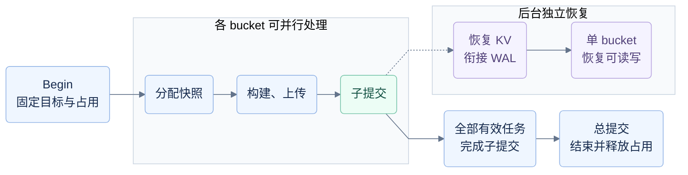
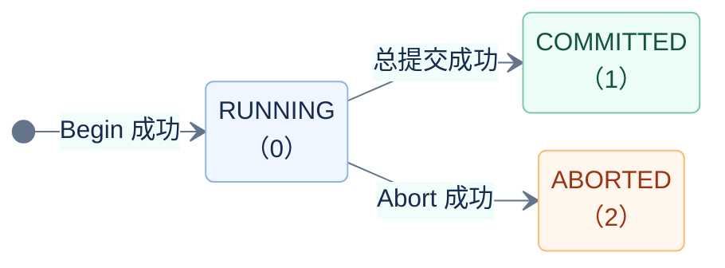
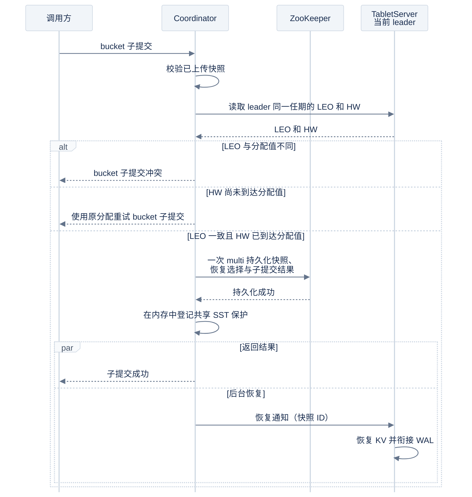
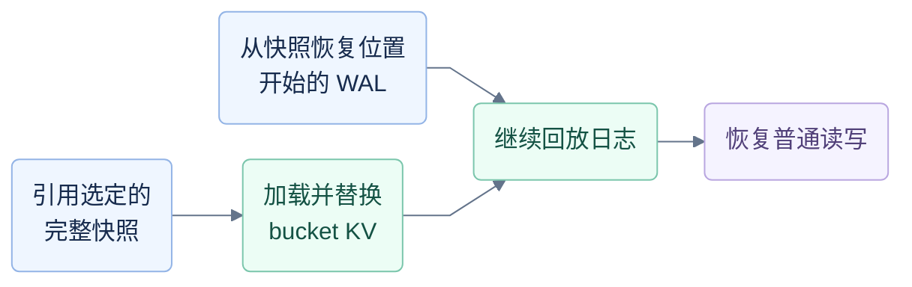

<!-- SPDX-License-Identifier: Apache-2.0 -->

# FIP-61：支持主键表的快照批量导入

| 项目 | 内容 |
| --- | --- |
| 讨论邮件 | 待发起 |
| 投票邮件 | 待发起 |
| ISSUE | 待确定 |
| 发布版本 | 待确定 |

## 1 动机

通过普通写入导入大规模 Fluss 主键表，需要承担逐条记录处理、WAL 写入、复制和后续快照构建的开销。当外部数据已经由批任务计算为完整的主键状态时，仍将这些记录逐条写入 TabletServer，会重复承担在线写入链路的成本。

BulkLoad 允许调用方在 TabletServer 之外构建普通 RocksDB 快照，上传后由服务端注册并恢复。它使用完整快照向新建或已有主键表中的空目标 bucket 导入数据。一个事务可以覆盖一张非分区表，或同一分区表的一个或多个分区；各 bucket 独立提交并异步可见。

本提案定义独立于数据源格式和执行引擎的 BulkLoad 协议，覆盖目标占用、快照分配与校验、bucket 子提交、总提交与中止、进度查询、故障恢复、权限和持久化元数据。主干已有外部快照的文件格式、普通快照注册、Replica 恢复和后续复制机制，本提案在这些能力上补齐导入流程。

湖表升级是 BulkLoad 的一个使用场景，具体升级流程见 [FIP-25：将既有 Paimon 表原地升级为支持湖存储的 Fluss 表](https://cwiki.apache.org/confluence/pages/viewpage.action?pageId=406623572)。BulkLoad 同样适用于其他数据源的批量导入。

批量初始化后接续流处理时，由上层初始化作业管理源端基线：

1. 确定源端快照及其对应的增量消费位置，基于该快照构建目标数据。
2. 持久保存源端位置、构建结果与 BulkLoad ID 的对应关系，失败重试沿用这组关系。
3. BulkLoad 事务提交成功后，从该源端基线之后启动增量处理。

多个源分别记录位置，由上层作业协调其基线。Fluss WAL offset 表示目标端的恢复位置，不表示源端消费进度；源端位置属于上层作业状态，不纳入 BulkLoad 协议。

## 2 公共接口

下文使用以下术语：

| 术语 | 含义 |
| --- | --- |
| 事务 | 一张表上的一次 BulkLoad，可以选择该表的多个分区 |
| 物理目标 | 非分区表本身，或分区表中的一个物理分区，后文简称目标 |
| bucket 子提交 | 持久化一个 bucket 的快照引用和提交结果，并触发后台恢复 |
| 恢复快照引用 | 指定一个 bucket 当前采用的恢复快照；更新时使用该 ZooKeeper 节点的数据版本做 CAS |

### 2.1 行为约定

#### 2.1.1 适用范围与事务目标

BulkLoad 主要用于向空目标 bucket 导入初始数据。调用方应使用空目标，并协调导入期间的普通写入。服务端不检查目标是否为空。发布 bucket 快照前，服务端检查当前 leader 的 WAL 末端 offset（LEO）等于分配值，且高水位（HW）已经到达该位置。这些校验不提供写入隔离。

| 对象 | 是否支持 | 最小目标与选择范围 |
| --- | --- | --- |
| 新建或已有的非分区主键表 | 支持 | 整张表 |
| 新建或已有的分区主键表 | 支持非历史分区 | 单个物理分区；一次事务可选择同一表的一个或多个分区 |
| 含自增列的表、历史分区 | 首版不支持 | — |
| partial update、aggregation 等 merge engine 表 | 后续分期支持 | 外部构建须生成目标引擎所需的完整状态，可能包含输出行之外的中间状态 |
| 多表事务 | 不支持 | 一个事务只能属于一张表 |

Begin 对含自增列的表或历史分区返回不支持的目标类型。目标和每个目标的 bucket 集合在 Begin 成功时固定，新增或重建的对象不自动加入。

构建期间的约束如下：

- 调用方保持表 schema、主键与 bucket 路由规则、目标 bucket 数和远程目录不变，使用 Begin 返回的上下文生成完整快照。
- 服务端在分配和子提交时核对构建上下文；发现变化时拒绝继续使用该输入，由调用方处理事务后重新 Begin。
- 与 DDL 并发的调用方约束及删除行为见 2.1.3.3 节。

#### 2.1.2 完成保证与可见性

服务端持久保存已完成子提交的快照，并异步恢复各 bucket。在目标仍存在、没有后续覆盖且服务恢复可用时，已完成子提交的快照最终可见。各 bucket 独立提交和恢复，BulkLoad 不提供跨 bucket 或跨分区的原子性、事务隔离或统一时点快照。后续写入、覆盖或删除可以继续改变数据。

| 操作结果 | 保证 |
| --- | --- |
| Begin 成功 | 固定目标集合，持久化事务并为全部目标建立占用记录 |
| 分配 bucket 快照成功 | 固定该事务、该 bucket 的 snapshot ID 和 WAL 恢复起点 |
| bucket 子提交成功 | 快照引用及提交结果已持久化，异步恢复已被触发 |
| bucket 恢复完成 | 完整快照已加载，并从快照记录的恢复起点继续处理 WAL |
| 总提交成功 | 全部仍有效目标的 bucket 已子提交，事务结束并解除目标占用 |

事务提交后，调用方可以启动正常的客户端操作；异步恢复期间的暂时不可用通过现有客户端重试机制处理，与普通副本恢复、迁移或切主保持一致。事务结束后立即允许下一次 Begin，前后事务的恢复和可见顺序由上层调用方负责协调。后续覆盖可以替代尚未执行的旧恢复请求；已经在途的旧工作不获得跨事务的顺序保证。

#### 2.1.3 并发、删除与重建

##### 2.1.3.1 并发行为

| 场景 | 服务端行为 | 调用方要求 |
| --- | --- | --- |
| 普通读写与 BulkLoad 并发 | 当前 leader 的 WAL 末端 offset 与分配时不同时，拒绝该 bucket 子提交。校验不拦截后续写入，恢复异步进行 | 自行协调普通读写，从分配到子提交完成期间暂停普通写入。恢复写入时如需保留写入结果，还要与 bucket 恢复协调 |
| 多个 BulkLoad 覆盖重叠物理目标 | 提供悲观互斥，持续到事务进入终态；后台恢复不延长占用 | 等待前一事务结束后再 Begin |
| 多个 BulkLoad 覆盖不相交分区 | 允许并行 | 按所选物理目标发起事务 |
| 前一事务结束，但恢复尚未完成时再次覆盖 | 允许 Begin；恢复与可见性的约定见 2.1.2 节 | 自行协调前后事务的恢复和可见顺序 |

##### 2.1.3.2 写入会话

恢复普通写入前，调用方应：

1. 停止并处理旧写入会话。
2. 使用新会话继续写入。Java 客户端在同一 Connection 内重新创建 writer 仍共享 WriterClient，需要新建 Connection 后创建 writer。

协议不保证旧 writer ID 和 batch sequence 跨覆盖连续，也不额外复制旧 writer 去重历史。

##### 2.1.3.3 DDL 并发、删除与重建

原分区删除后不再计入事务完成条件，称为该目标退出事务。有效目标指尚未退出事务的目标。

| DDL 场景 | 行为 |
| --- | --- |
| 修改影响快照构建或恢复的表定义、配置 | 调用方自行协调，避免与 BulkLoad 冲突；BulkLoad 不提供额外的 DDL 隔离保证 |
| 新增分区 | 不加入 Begin 时固定的目标集合 |
| 进行中删除表 | 事务视为中止，相关 BulkLoad 信息不可查并清理；数据随表删除处理 |
| 进行中删除分区 | 原物理分区退出事务，剩余 bucket 不再阻碍总提交 |
| 同名重建分区 | 新 partition ID 不加入原事务，不接收旧输入 |
| 同名重建表 | 新 table ID 不继承原事务或恢复工作 |
| 全部目标分区删除、表仍存在 | 没有剩余任务，可以总提交成功 |
| 事务结束后删除分区 | 不改写已保留的事务结果 |
| 事务结束后删除表 | 相关 BulkLoad 信息不可查并清理，不等待结果保留期 |
| 其他 DDL | 沿用现有行为，BulkLoad 不增加拦截或串行化 |

DDL 并发遵循以下约定：

- 普通 DDL 保持主干执行模型，BulkLoad 不增加 DDL 锁，也不要求 DDL 等待事务或副本恢复完成。
- 调用方协调 ALTER 时，需要考虑快照构建、上传、提交和异步恢复阶段；总事务完成不代表全部 bucket 已恢复可读。分配和子提交时的构建上下文核对不替代调用方的并发协调。

名称用于目标选择和定位，table ID、partition ID 用于绑定实际对象。删除状态通过物理 ID 核对、元数据事件和维护流程反映到事务；恢复工作不得作用于同名新对象。

删表优先于事务结果保留：旧 handle 的查询和重试均失败。`ListInProgressBulkLoads` 在表不存在时返回表不存在，同名重建后只查询新 table ID 的事务。

### 2.2 Coordinator RPC

BulkLoad RPC 由 Coordinator 处理。调用方先 Begin，再按 bucket 分配快照、构建上传并子提交，最后提交总事务。以下定义为服务端 RPC，SDK 和执行引擎可以封装这些操作。新增客户端 RPC 使用 version 0。

| RPC | 成功结果 | 重试与失败语义 |
| --- | --- | --- |
| `BeginBulkLoad` | 固定目标集合并建立占用记录，返回 handle 和构建上下文 | 指定相同 `bulk_load_id` 可重试；不同目标不能复用同一 ID |
| `AllocateBulkLoadBucketSnapshot` | 返回该 bucket 固定的 snapshot ID 和 WAL 恢复起点 | 重试返回原分配结果；已子提交时返回 COMMITTED |
| `CommitBulkLoadBucketSnapshot` | 持久化快照引用和子提交结果，触发异步恢复 | 重复提交返回原结果，不重新发布覆盖 |
| `CommitBulkLoad` | 确认全部有效任务已子提交，结束事务并解除目标占用 | 不等待恢复可读；存在未完成任务时返回未完成 |
| `AbortBulkLoad` | 中止事务并解除目标占用 | 不回滚已完成子提交的快照；不能中止已 COMMITTED 的事务 |
| `GetBulkLoadInfo` | 返回指定事务的状态及全部目标摘要 | 未知、已回收或原表已删除的 handle 返回事务不存在 |
| `ListInProgressBulkLoads` | 返回指定表或分区上进行中的事务 | 按事务去重；没有有效占用时返回空列表 |

#### 2.2.1 事务操作

##### 2.2.1.1 公共类型

```protobuf
message PbBulkLoadHandle {
  required int64 table_id = 1;
  required string bulk_load_id = 2;
}

message PbBulkLoadStatus {
  required PbBulkLoadHandle handle = 1;
  required int32 state = 2;
  required int64 created_time = 3;
  optional int64 finished_time = 4;
  optional string abort_message = 5;
}

message PbBulkLoadTargetInfo {
  optional int64 partition_id = 1;
  optional string partition_name = 2;
  required int32 bucket_count = 3;
  required string remote_data_dir = 4;
}
```

公共字段规则如下：

- `PbBulkLoadStatus.state` 表示事务状态，编码与转换见 3.2.1.1 节。
- `AllocateBulkLoadBucketSnapshotResponse.state` 表示 bucket 状态，编码与转换见 3.2.1.2 节。
- 所有时间字段采用 Unix epoch 毫秒；`finished_time` 仅在终态返回。
- `abort_message` 是调用方可选提供的中止说明，仅在 ABORTED 且已保存说明时返回。

##### 2.2.1.2 Begin

```protobuf
message BeginBulkLoadRequest {
  required PbTablePath table_path = 1;
  repeated string partition_names = 2;
  optional string bulk_load_id = 3;
}

message BeginBulkLoadResponse {
  required PbBulkLoadStatus status = 1;
  required PbTableInfo table_info = 2;
  repeated PbBulkLoadTargetInfo targets = 3;
}
```

目标选择、`bulk_load_id` 格式及重复 Begin 的规则见 3.2.2.1 节。

Begin 返回的构建信息如下：

| 返回项 | 含义 |
| --- | --- |
| `table_info` | 一份公共表信息，`table_id` 与 handle 一致 |
| `targets` 中的分区 ID 和名称 | 分区目标返回原物理 partition ID 和名称；非分区目标省略这两个字段 |
| 各目标的 bucket 数和远程目录 | 分别返回该目标实际生效的构建信息 |

##### 2.2.1.3 分配 bucket 快照

```protobuf
message AllocateBulkLoadBucketSnapshotRequest {
  required PbBulkLoadHandle handle = 1;
  optional int64 partition_id = 2;
  required int32 bucket_id = 3;
}

message AllocateBulkLoadBucketSnapshotResponse {
  required int64 snapshot_id = 1;
  required int32 state = 2;
  required int64 log_offset = 3;
}
```

响应中的 `state` 使用 3.2.1.2 节的 bucket 状态编码。请求范围、分配过程及重复请求的处理见 3.2.2.2 节。

##### 2.2.1.4 Bucket 子提交

```protobuf
message CommitBulkLoadBucketSnapshotRequest {
  required PbBulkLoadHandle handle = 1;
  optional int64 partition_id = 2;
  required int32 bucket_id = 3;
}

message CommitBulkLoadBucketSnapshotResponse {}
```

##### 2.2.1.5 总提交

```protobuf
message CommitBulkLoadRequest {
  required PbBulkLoadHandle handle = 1;
}

message CommitBulkLoadResponse {
  required PbBulkLoadStatus status = 1;
}
```

##### 2.2.1.6 中止事务

```protobuf
message AbortBulkLoadRequest {
  required PbBulkLoadHandle handle = 1;
  optional string abort_message = 2;
}

message AbortBulkLoadResponse {
  required PbBulkLoadStatus status = 1;
}
```

#### 2.2.2 查询操作

##### 2.2.2.1 获取事务信息

`GetBulkLoadInfo` 按 handle 返回事务状态及全部原始目标的进度摘要。

```protobuf
message GetBulkLoadInfoRequest {
  required PbBulkLoadHandle handle = 1;
}

message PbBulkLoadTargetProgress {
  optional int64 partition_id = 1;
  required int32 bucket_count = 2;
  required int64 allocated_bucket_count = 3;
  required int64 committed_bucket_count = 4;
  required bool withdrawn = 5;
}

message GetBulkLoadInfoResponse {
  required PbBulkLoadStatus status = 1;
  repeated PbBulkLoadTargetProgress targets = 2;
}
```

| 字段 | 含义 |
| --- | --- |
| `partition_id` | 原物理 partition ID；非分区目标省略 |
| `bucket_count` | Begin 固定的 bucket 数 |
| `allocated_bucket_count` | 已分配快照的 bucket 数，包含已完成子提交的 bucket |
| `committed_bucket_count` | 已完成子提交的 bucket 数 |
| `withdrawn` | 原分区已删除并退出事务时为 true，不再计入剩余任务 |

结果范围与完成条件：

- 分区表按原物理 partition ID 升序返回；非分区表只有一项目标。
- 原分区被删除后仍出现在结果中，重建分区不加入原事务；全部目标退出时没有剩余任务。
- 只返回目标摘要；构建所需的表信息和远程目录由 Begin 返回。
- 进度表示分配和子提交数量，不表示下载或恢复完成数量；全部有效 bucket 已子提交后，仍需执行总提交。
- 查询失败的返回值见 2.3.2 节。

查询不提供跨目标的一致时点快照，查询期间发生的子提交、分区删除或事务结束可以在后续查询中反映。

##### 2.2.2.2 列出进行中的事务

```protobuf
message ListInProgressBulkLoadsRequest {
  required PbTablePath table_path = 1;
  repeated string partition_names = 2;
}

message ListInProgressBulkLoadsResponse {
  repeated PbBulkLoadStatus transactions = 1;
}
```

| 表类型 | `partition_names` | 查询范围 |
| --- | --- | --- |
| 非分区表 | 必须为空 | 整张表 |
| 分区表 | 为空 | 整张表 |
| 分区表 | 非空且无重复名称 | 指定分区；事务覆盖任一指定分区即匹配 |

返回规则如下：

- 表或指定分区不存在时返回错误。
- 按当前物理对象读取有效占用记录，只返回 RUNNING 事务，不包含终态历史事务。
- 同一事务只返回一次；没有进行中的事务时返回空列表。
- 发现 handle 后，可通过 `GetBulkLoadInfo` 获取完整目标摘要。

列出事务与获取信息是两次独立查询，期间事务可能进入终态。原表仍存在时，`GetBulkLoadInfo` 返回其保留的结果；查询本身不建立占用记录或接管执行。

### 2.3 权限与错误语义

#### 2.3.1 权限

沿用所属表的 ACL，分区不增加独立权限类型。每次请求按当前认证主体检查权限：

| RPC | 表权限 |
| --- | --- |
| Begin、分配快照、bucket 子提交、总提交、Abort | WRITE |
| 获取事务信息、列出进行中的事务 | DESCRIBE |

- handle 只标识事务；有相应表权限的调用方可以继续处理，操作权限不限定于创建者。
- 按 handle 操作时，先确认原 table ID 仍存在，再检查表权限；同名重建后的新表不能替代原表。
- 私有 NotifyLeaderAndIsr 沿用 Coordinator 到 TabletServer 的内部鉴权。

#### 2.3.2 错误语义

沿用 Fluss 的 ErrorResponse，具体错误码在 RPC 实现时注册。

| 条件 | 返回语义 |
| --- | --- |
| 参数或目标范围不合法 | 非法请求 |
| handle 未找到、已回收或原表已删除 | 事务不存在 |
| 目标被其他 RUNNING 事务占用 | 目标占用冲突 |
| 当前 leader 的 WAL 末端 offset 与 bucket 分配值不同 | 发布前拒绝该 bucket 子提交，返回 `BULK_LOAD_CONFLICT` |
| LEO 等于分配值，但 leader HW 尚未到达该位置 | 发布前拒绝该 bucket 子提交，返回可重试错误 |
| 总提交时尚有 bucket 未完成 | 事务未完成 |
| 请求与已中止或已提交的事务状态冲突 | 可区分的事务状态错误 |
| 快照输入不合法 | 快照输入错误 |
| 对已退出分区发起新的分配或子提交 | 目标已退出；通过 `GetBulkLoadInfo` 确认剩余任务 |
| 权限不足 | 现有鉴权错误，不返回占用事务详情 |

重试规则如下：

- 已完成子提交的 bucket 重试仍返回成功；尚未子提交的 bucket 在事务终止后拒绝提交。
- 发生 offset 冲突后，先解决并发写入，再发起新事务获取新的分配结果。原事务中重复分配仍返回原 snapshot ID 和 offset。
- 仅 HW 校验失败时，待 WAL 追上后用原分配和已上传的快照重试。
- 分区退出不等于 bucket 已子提交。
- 元数据服务故障或 RPC 超时可能意味着结果未知；调用方使用相同身份查询或重试。

### 2.4 内部快照与恢复协议

普通快照提交复用 [#5229](https://github.com/apache/fluss/pull/5229) 合入主干的协议。BulkLoad 在 `NotifyLeaderAndIsr` version 1 增加按快照 ID 发出的恢复通知。

#### 2.4.1 普通快照提交

BulkLoad 复用 `CommitKvSnapshotRequest` 的既有字段：

```protobuf
// Added to CommitKvSnapshotRequest.
optional int64 previous_recovery_snapshot_id = 4;
```

| 字段 | 含义 |
| --- | --- |
| `previous_recovery_snapshot_id` | 生成快照的 KV 上下文所对应的选定快照 ID，在快照同步准备时一并捕获 |

Coordinator 先登记普通快照引用，再尝试推进恢复选择。字段缺省时沿用主干兼容路径，可以尽力创建或推进选择，不比较前序快照 ID。携带字段时的快照身份与角色校验见 3.4.2 节。

#### 2.4.2 角色与恢复通知

在 `NotifyLeaderAndIsr` 的已有逐 bucket 消息中增加：

```protobuf
// Added to PbNotifyLeaderAndIsrReqForBucket.
optional int64 recovery_snapshot_id = 11;

// Added to PbNotifyLeaderAndIsrRespForBucket.
optional int64 recovered_snapshot_id = 4;
```

| 通知或响应 | 含义 |
| --- | --- |
| 请求未携带 `recovery_snapshot_id` | 普通角色通知 |
| 请求携带 `recovery_snapshot_id` | 要求当前 leader 核对选定快照 ID，按需安排异步恢复 |
| 无错误，未携带 `recovered_snapshot_id` | 恢复尚未完成，或请求快照已被替换；Coordinator 按当前引用重试 |
| 无错误，携带 `recovered_snapshot_id` | 当前 leader 的 KV 已对应反馈的快照 ID |

完成反馈只有同时匹配本轮请求和当前恢复引用选定的快照 ID，才结束该 bucket 的通知重试。通知沿用物理 bucket 身份、Coordinator epoch 和 leader epoch 检查，不提高 leader epoch，也不等待完整下载或全部副本确认。通知与接管流程见 3.4.4 节。快照 ID 仅比较是否相等，不按分配顺序判断新旧。Replica 在安排恢复前重读持久引用，并在反馈完成前再次核对。

### 2.5 配置

新增以下两项服务端配置：

| 配置 | 默认值 | 取值 | 含义 |
| --- | --- | --- | --- |
| `coordinator.bulkload.max-targets` | 1000 | 正整数 | 限制一次 Begin 选择的物理目标数量，约束 ZooKeeper multi 大小。非分区表只有一个目标，分区表按所选分区计数。 |
| `coordinator.bulkload.result-retention` | 7 天 | 正时长 | 原表仍存在时，从事务进入 COMMITTED 或 ABORTED 起，至少保留事务结果及 bucket 记录的时间，也是幂等重试的有效期限。删除表时清理对应记录。 |

## 3 方案设计

### 3.1 架构与导入流程

快照登记保存可恢复的文件引用，恢复快照引用指定当前恢复源。BulkLoad 子提交选择导入快照，恢复后由基于该 KV 的普通快照继续推进引用。

| 组件 | 职责 |
| --- | --- |
| 调用方或批处理作业 | 协调普通读写，构建并上传各 bucket 的完整快照，执行子提交和总提交 |
| Coordinator | 管理目标占用和事务状态，校验快照并持久化提交结果，触发恢复和保留事务结果 |
| TabletServer | 按恢复快照引用加载 KV，衔接 WAL，继续普通复制和读写 |
| ZooKeeper | 保存事务、目标占用、bucket 子提交结果、普通快照引用和恢复快照引用 |

**图 1　并行导入与后台恢复**



图中实线表示步骤依赖，虚线表示异步触发。各 bucket 可并行处理；后台恢复独立推进，总提交与各 bucket 恢复完成没有先后依赖。

### 3.2 事务执行

#### 3.2.1 状态转换

事务状态描述整次导入是否结束，bucket 状态描述单个快照是否已完成子提交。两者独立推进。

##### 3.2.1.1 事务状态

图 2 括号内的数字为 `PbBulkLoadStatus.state` 的协议编码。

**图 2　事务状态转换**



- RUNNING：事务进行中，接受快照分配和 bucket 子提交。
- COMMITTED：全部尚未退出事务的目标的 bucket 已子提交，总提交成功并解除目标占用。
- ABORTED：显式中止成功，停止接受后续输入并解除目标占用；已完成子提交的快照不回滚。

事务只从 RUNNING 进入一个终态，终态之间不转换。Begin 成功时固定目标与 bucket 集合并建立占用记录。终态记录按结果保留规则回收，见 3.5.3 节。

##### 3.2.1.2 Bucket 状态

图 3 括号内的数字为 bucket 状态的协议编码，用于快照分配响应和持久化 bucket 记录。

**图 3　Bucket 状态转换**


未分配表示该 bucket 尚无分配记录，不是持久化状态。分配成功后，ALLOCATED 记录固定 snapshot ID 和恢复起点；子提交成功后，COMMITTED 表示快照引用和提交结果已持久化，并已触发异步恢复。

bucket 的 COMMITTED 不表示事务已结束；事务的 COMMITTED 也不表示所有 bucket 已恢复可读。

##### 3.2.1.3 删除与重复请求

以下重试规则适用于原表仍存在、事务记录尚未回收的情况。

| 情况 | 行为 |
| --- | --- |
| COMMITTED 后重复总提交 | 返回原提交结果；不能再执行 Abort |
| ABORTED 后重复 Abort | 返回原中止结果和说明；不能再执行总提交 |
| 已子提交的 bucket 重复提交 | 返回原成功结果，不重新发布快照或触发一次新的覆盖 |
| 事务终止后，为尚未子提交的 bucket 分配或提交快照 | 拒绝请求，不接受新输入 |
| RUNNING 期间删除原物理分区 | 该目标退出完成条件，事务仍为 RUNNING，无需逐 bucket 写入跳过状态 |
| 删除原表 | 进行中的事务视为中止，所有相关事务信息不可查并清理，见 2.1.3.3 节 |

#### 3.2.2 Begin 与快照分配

##### 3.2.2.1 Begin

| 表类型 | `partition_names` 要求 |
| --- | --- |
| 非分区表 | 必须为空 |
| 分区表 | 必须明确提供非空、无重复的分区列表；空列表不表示全表 |

首次 Begin 的处理步骤：

1. 解析所属表和物理分区，检查目标数量上限，固定各目标的 bucket 数。
2. 在一次有界的 ZooKeeper multi 中创建事务及全部目标，并建立占用记录。任一目标冲突则整体失败，不保留部分占用；冲突结果应能帮助有权限的调用方发现当前占用事务。
3. 返回 handle、Begin 时固定的表信息，以及各目标的物理 ID、bucket 数和实际远程目录。表信息复用 `PbTableInfo`。

Begin 不展开 bucket 快照 ID 数组，不访问 replica，也不等待副本确认。

`bulk_load_id` 的规则如下：

| 项目 | 规则 |
| --- | --- |
| 标识范围 | 在物理 table ID 范围内标识一次事务 |
| 来源 | 调用方指定；省略时由服务端生成 UUID |
| 格式 | 1 到 128 个字符；首位为英文字母或数字，其余允许英文字母、数字、连字符、下划线和点，不含路径分隔符 |
| 重复 Begin | 原表仍存在且结果保留期内，命中已有 ID 时返回原事务及状态，不重新获取目标快照；不同目标选择不能复用同一 ID |
| 调用方约束 | 同一 table ID 下不复用 ID，结果保留期外不重试原 Begin |
| 回收后行为 | 服务端不保留永久去重记录，不能识别任意久远的 Begin 重放 |

需要可靠重试时应指定 `bulk_load_id`。未指定 ID 且响应丢失时，可通过 `ListInProgressBulkLoads` 发现事务；再次 Begin 不保证命中原事务。

##### 3.2.2.2 分配 bucket 快照

请求定位规则：

- 分区表携带 Begin 固定的物理 partition ID；非分区表省略。
- bucket ID 必须在固定目标范围内。

首次分配的处理步骤：

1. 沿用主干每个物理 bucket 的 `snapshot_seqid` 分配 snapshot ID。
2. 取得当前 leader 的 LEO 作为恢复起点。HW 在 bucket 子提交时校验。
3. 持久化 snapshot ID、恢复起点及 ALLOCATED 状态后返回。

| 情况 | 处理 |
| --- | --- |
| 重复分配 | 返回相同 snapshot ID、`log_offset` 和当前状态 |
| bucket 已子提交 | 返回 COMMITTED，调用方不再构建 |
| bucket 尚未子提交，但事务已结束 | 拒绝继续分配 |
| leader 不可用或元数据存储故障 | 分配可能失败或结果未知 |
| 分配中产生未被采用的序列号 | 允许空号，不对应文件资源 |

#### 3.2.3 Bucket 子提交

调用方使用已分配的 snapshot ID 和恢复起点，上传文件及普通 `_METADATA`。上传完成后才子提交；子提交开始后不得修改输入。服务端可以根据固定目标、snapshot ID 和标准目录定位 `_METADATA`，请求无需重复携带路径或文件清单。

首次子提交的处理步骤：

1. 校验快照的 table ID、partition ID、bucket ID、snapshot ID、`log_offset` 及必要的文件描述。
2. 发布前检查当前 leader 同一任期内的 LEO 和 HW。LEO 与分配值不同时返回 `BULK_LOAD_CONFLICT`。LEO 一致但 HW 尚未到达分配值时返回可重试错误。两种情况都不发布快照，bucket 保持未提交。调用方负责协调写入直到提交完成。
3. 通过一次 ZooKeeper multi 建立普通快照引用、更新恢复快照引用，将 bucket 记录标记为 COMMITTED。
4. 在 Coordinator 的内存快照存储中登记已提交快照及共享 SST 引用，并安排后台恢复。

同一事务内，一个 bucket 只提交一次快照。重复提交先读取已提交结果，直接返回成功，不重新读取输入或产生新的覆盖操作。尚未分配时拒绝提交；尚未提交且事务已结束时拒绝提交。已删除目标不会被替换为同名新对象。

持久化成功后，Coordinator 在现有 bucket 锁内同步登记保护共享 SST 所需的内存状态，再返回子提交结果。Replica 恢复和旧快照回收在后台执行。

**图 4　单 bucket 子提交时序**



时序图展示快照已上传后的首次子提交。子提交响应无需等待并行分支中的恢复。恢复完成通过后续通知确认，见 2.4 节。

#### 3.2.4 总提交与中止

| 行为 | `CommitBulkLoad` | `AbortBulkLoad` |
| --- | --- | --- |
| 前置条件 | 全部有效任务已子提交；存在未完成任务时直接返回未完成 | 事务为 RUNNING |
| 状态与占用变化 | 写入 COMMITTED，解除目标占用 | 写入 ABORTED，停止接受后续子提交，解除目标占用 |
| 已完成子提交的快照 | 不等待恢复可读，完成保证见 2.1.2 节 | 不回滚，恢复可以继续 |
| 重复请求 | 返回原提交结果 | 返回原中止结果 |
| 终态冲突 | ABORTED 不能改为 COMMITTED | COMMITTED 不能改为 ABORTED |

`abort_message` 的处理规则：

- 调用方可选提供简短中止说明，用于诊断，不参与状态转换，不保存异常堆栈。
- 首次成功 Abort 时，说明与 ABORTED 状态在同一次原子更新中保存；未提供时省略。
- 查询和重复 Abort 返回原说明；重试不改写说明，也不补填首次省略的说明。

并发处理规则：

| 并发操作 | 判定依据 |
| --- | --- |
| Abort 与 bucket 子提交 | 原子元数据操作的持久化顺序决定子提交是否生效 |
| Abort 与总提交 | 首次持久化的终态生效 |

总提交按固定 bucket 数以有界并发核对，不要求一次加载全部 bucket。提交状态单向推进，删除的物理分区不重新加入，因此无需每次子提交争用一个全局完成计数器。完成检查与事务终态通过版本检查衔接，不能让 Abort 后的迟到操作继续提交新快照。

### 3.3 持久化元数据

BulkLoad 的持久化信息分别存放在两个位置：

- **ZooKeeper**：保存事务进度、目标占用及恢复所需的快照引用，布局和记录定义见 3.3.1 节。
- **远程存储**：保存 `_METADATA` 和 SST 等快照文件，目录及文件格式见 3.3.2 节。

进度查询读取事务记录。数据恢复先读取物理 bucket 的恢复快照引用，再按指定 snapshot ID 取得普通快照引用中的 `metadata_path` 并加载远程文件。事务结果回收不改变恢复快照引用。

#### 3.3.1 ZooKeeper 元数据

##### 3.3.1.1 节点布局

`$ZK_ROOT` 表示配置的 ZooKeeper 根路径。以下仅展示与 BulkLoad 相关的节点。

- `[新增]` 表示本提案引入的路径结构或记录；标在子树根部时适用于整个子树。新增节点均为持久节点。
- `[已有]` 表示主干已有的路径结构或记录格式，BulkLoad 沿用这些结构。
- 树中的章节编号指向该记录的定义；未说明用途的中间节点只组织路径。

```text
$ZK_ROOT
├── bulk_load/                                      [新增] 事务元数据子树
│   └── tables/{tableId}/
│       ├── transactions/{bulkloadId}                事务记录 → 3.3.1.2
│       │   └── targets/
│       │       ├── table/                          非分区目标记录 → 3.3.1.3
│       │       │   └── buckets/{bucketId}           bucket 记录 → 3.3.1.4
│       │       └── partitions/{partitionId}/       分区目标记录 → 3.3.1.3
│       │           └── buckets/{bucketId}           bucket 记录 → 3.3.1.4
│       └── owners/
│           ├── table                               非分区目标占用记录 → 3.3.1.5
│           └── partitions/{partitionId}            分区目标占用记录 → 3.3.1.5
└── tabletservers/                                  [已有]
    ├── tables/{tableId}/buckets/{bucketId}/          [已有] 非分区表的物理 bucket
    │   ├── snapshot_seqid                          [已有] 快照 ID 序列
    │   ├── recovery_snapshot                       [已有] 恢复快照引用 → 3.3.1.6
    │   └── snapshots/{snapshotId}                   [已有] 普通快照引用 → 3.3.1.7
    └── partitions/{partitionId}/buckets/{bucketId}/ [已有] 分区表的物理 bucket
        ├── snapshot_seqid                          [已有] 快照 ID 序列
        ├── recovery_snapshot                       [已有] 恢复快照引用 → 3.3.1.6
        └── snapshots/{snapshotId}                   [已有] 普通快照引用 → 3.3.1.7
```

非分区事务只使用 `targets/table` 和 `owners/table`；分区事务使用所选物理分区对应的节点。普通表、分区 registration 和 LeaderAndIsr 保持主干格式。

###### 3.3.1.1.1 事务进度与副本恢复

事务下的 bucket 记录保存本次导入的固定结果；物理 bucket 下的恢复快照引用指定当前恢复源，两者的生命周期如下：

| 记录 | 用途 | 后续快照提交后 | 清理时机 |
| --- | --- | --- | --- |
| 事务下的 bucket 记录 | 进度查询及幂等重试 | 保留原事务的 snapshot ID、恢复起点和提交状态 | 事务结果保留期结束，或表被删除 |
| 物理 bucket 下的恢复快照引用 | 为当前及后续 leader 指定恢复源 | 可由后续导入替换，也可由基于当前 KV 的普通快照推进 | bucket 或表被删除 |

例如，事务 A 子提交快照 17，之后普通快照 18 推进恢复引用。A 的 bucket 记录仍返回快照 17；回收 A 的事务结果不影响从快照 18 恢复。

占用记录用于重叠目标的事务互斥，事务进入终态后立即逻辑失效。普通快照引用用于现有快照管理，其保留与回收独立于事务结果。

以下各节按树中的编号定义记录。新增记录采用 version 1 JSON，时间为 Unix epoch 毫秒。事务及子任务的物理 ID 和 `bulk_load_id` 从路径读取，占用记录则保存它引用的事务 ID。

##### 3.3.1.2 事务记录

路径：`$ZK_ROOT/bulk_load/tables/{tableId}/transactions/{bulkloadId}`。

该节点保存整次导入的状态和公共构建上下文，字段如下：

| 字段 | 类型 | 含义 |
| --- | --- | --- |
| `version` | int32 | 格式版本，值为 1 |
| `state` | int32 | `0=RUNNING`、`1=COMMITTED`、`2=ABORTED`；状态转换见 3.2.1.1 节 |
| `table_path` | object | `database_name`、`table_name` 两个字符串，用于显示及定位原表 |
| `table_info` | object | Begin 固定的公共构建上下文 |
| `created_time` | int64 | 事务创建时间 |
| `finished_time` | int64，可选 | 进入终态的时间，RUNNING 时省略 |
| `abort_message` | string，可选 | 首次 Abort 提供的说明，仅在 ABORTED 时保存 |

`table_info` 与 RPC 中 `PbTableInfo` 的映射如下：

| 字段 | 持久化与返回方式 |
| --- | --- |
| `table_id` | 从事务路径补入 `PbTableInfo` |
| `schema_id`、`created_time`、`modified_time` | 保存在 `table_info` 中，按名映射到 RPC 字段 |
| `table_json` | 保存 `TableDescriptorJsonSerde` 的 JSON 对象，包含既有 schema 编码；返回 RPC 时编码为 UTF-8 bytes |
| `remote_data_dir`、`bucket_count_epoch` | 存在时保存在 `table_info` 中，按名映射到 RPC 字段 |

事务记录不保存目标列表、bucket 数组或进度计数。schema 和表定义只保存这一份，各目标的差异放在目标节点中。

##### 3.3.1.3 目标记录

| 目标类型 | 目标记录路径 |
| --- | --- |
| 非分区表 | `$ZK_ROOT/bulk_load/tables/{tableId}/transactions/{bulkloadId}/targets/table` |
| 分区表的物理分区 | `$ZK_ROOT/bulk_load/tables/{tableId}/transactions/{bulkloadId}/targets/partitions/{partitionId}` |

目标节点保存 Begin 固定的实际 bucket 数、远程目录，以及该目标是否退出事务。分区目标还保存分区名称：

```json
{
  "version": 1,
  "partition_name": "p1",
  "bucket_count": 128,
  "remote_data_dir": "s3://warehouse/fluss",
  "withdrawn": false
}
```

| 字段 | 类型 | 含义 |
| --- | --- | --- |
| `version` | int32 | 格式版本，值为 1 |
| `partition_name` | string，可选 | 原分区名称，非分区目标省略 |
| `bucket_count` | int32 | Begin 固定的实际 bucket 数 |
| `remote_data_dir` | string | 该物理目标实际生效的目录，查询时不重新套用当前配置 |
| `withdrawn` | bool | 目标是否已退出事务，初始为 false |

目标的构建信息对应 Begin 返回的 `PbBulkLoadTargetInfo`。目标记录数受单事务目标数上限约束。

`withdrawn` 的更新规则：

- RUNNING 期间确认原分区已删除后，通过事务和目标版本检查置为 true。
- 事务结束后保持结束时的任务范围，不因后续分区删除改写记录。

##### 3.3.1.4 Bucket 记录

| 目标类型 | Bucket 记录路径 |
| --- | --- |
| 非分区表 | `$ZK_ROOT/bulk_load/tables/{tableId}/transactions/{bulkloadId}/targets/table/buckets/{bucketId}` |
| 分区表的物理分区 | `$ZK_ROOT/bulk_load/tables/{tableId}/transactions/{bulkloadId}/targets/partitions/{partitionId}/buckets/{bucketId}` |

每个 bucket 在首次分配快照时创建记录，保存固定的 snapshot ID、恢复起点和任务状态。以下是子提交成功后的 bucket 记录：

```json
{
  "version": 1,
  "snapshot_id": 17,
  "log_offset": 1000,
  "state": 1
}
```

| 字段 | 类型 | 含义 |
| --- | --- | --- |
| `version` | int32 | 格式版本，值为 1 |
| `snapshot_id` | int64 | 首次分配后固定的 snapshot ID |
| `log_offset` | int64 | 首次分配后固定的 WAL 恢复起点 |
| `state` | int32 | ALLOCATED 为 0，COMMITTED 为 1；子提交更新状态，重复请求读取原结果 |

记录随事务结果回收，未分配的 bucket 没有记录。

##### 3.3.1.5 占用记录

| 目标类型 | 占用记录路径 |
| --- | --- |
| 非分区表 | `$ZK_ROOT/bulk_load/tables/{tableId}/owners/table` |
| 分区表的物理分区 | `$ZK_ROOT/bulk_load/tables/{tableId}/owners/partitions/{partitionId}` |

每个物理目标最多有一条占用记录（owner），指向当前占用它的事务：

```json
{
  "version": 1,
  "bulk_load_id": "load-20261112-001"
}
```

| 字段 | 类型 | 含义 |
| --- | --- | --- |
| `version` | int32 | 格式版本，值为 1 |
| `bulk_load_id` | string | 当前占用该目标的事务 ID |

占用记录的生命周期：

- 引用 RUNNING 事务时有效。
- 事务进入终态后立即逻辑失效；下一次 Begin 可以原子替换，无需等待后台删除。
- 清理和替换都核对记录版本及事务归属，不删除后续事务的占用。

##### 3.3.1.6 恢复快照引用

| 目标类型 | 恢复快照引用路径 |
| --- | --- |
| 非分区表 | `$ZK_ROOT/tabletservers/tables/{tableId}/buckets/{bucketId}/recovery_snapshot` |
| 分区表的物理分区 | `$ZK_ROOT/tabletservers/partitions/{partitionId}/buckets/{bucketId}/recovery_snapshot` |

每个启用该能力的物理 bucket 保存一条引用：

```json
{
  "version": 1,
  "snapshot_id": 17
}
```

| 字段 | 类型 | 含义 |
| --- | --- | --- |
| `version` | int32 | JSON 格式版本，值为 1 |
| `snapshot_id` | int64 | 当前选定的恢复快照 ID，对应 3.3.1.7 节的普通快照引用 |

并发更新使用该节点的 ZK 数据版本，与 JSON 的格式版本不同；节点内容不重复保存 WAL offset 或文件路径。引用独立于事务结果保留，恢复完成反馈不修改它，删除物理 bucket 时随其清理。引用的更新规则见 3.4.2 节。

##### 3.3.1.7 普通快照引用

子提交后的快照使用主干已有的普通快照引用。

| 目标类型 | 普通快照引用路径 |
| --- | --- |
| 非分区表 | `$ZK_ROOT/tabletservers/tables/{tableId}/buckets/{bucketId}/snapshots/{snapshotId}` |
| 分区表的物理分区 | `$ZK_ROOT/tabletservers/partitions/{partitionId}/buckets/{bucketId}/snapshots/{snapshotId}` |

节点内容沿用 `BucketSnapshot` 记录：

```json
{
  "version": 1,
  "snapshot_id": 17,
  "log_offset": 1000,
  "metadata_path": "s3://warehouse/fluss/kv/db/orders-100/p1-p201/0/snap-17/_METADATA"
}
```

| 字段 | 类型 | 含义 |
| --- | --- | --- |
| `version` | int32 | 格式版本，值为 1 |
| `snapshot_id` | int64 | 该快照的 snapshot ID |
| `log_offset` | int64 | 该快照的 WAL 恢复起点 |
| `metadata_path` | string | 远程快照目录中的 `_METADATA` 路径 |

BulkLoad 子提交时，snapshot ID 和恢复起点与同次原子写入的事务 bucket 记录一致，恢复快照引用指向该 snapshot ID。后续快照可以推进恢复引用，原事务结果保持不变。快照文件按普通保留策略回收；当前恢复引用的保护规则见 3.5.3 节。

#### 3.3.2 远程快照文件

##### 3.3.2.1 目录布局

远程文件沿用主干 KV 快照目录，保存快照元数据和数据文件。

| 目标类型 | 快照目录 |
| --- | --- |
| 非分区表 | `{remote_data_dir}/kv/{database}/{table}-{tableId}/{bucketId}/snap-{snapshotId}/` |
| 分区表 | `{remote_data_dir}/kv/{database}/{table}-{tableId}/{partition}-p{partitionId}/{bucketId}/snap-{snapshotId}/` |

每个快照目录的内容如下；文件名和层级由 `_METADATA` 中的文件清单描述。

```text
snap-{snapshotId}/
├── _METADATA                快照元数据，格式见 3.3.2.2
└── 快照文件                  _METADATA 引用的 SST 等文件
```

快照完成子提交后，由普通快照引用和保留机制管理；删表时随数据清理。

##### 3.3.2.2 快照元数据文件

路径：3.3.2.1 节快照目录下的 `_METADATA`。

`_METADATA` 使用 `KvSnapshotFileMetadataJsonSerde` 的普通 version 1 JSON，保存物理 ID、恢复起点、行数和文件清单。以下示例只展示一个 private file：

```json
{
  "version": 1,
  "table_id": 100,
  "partition_id": 201,
  "bucket_id": 0,
  "snapshot_id": 17,
  "snapshot_location": "s3://warehouse/fluss/kv/db/orders-100/p1-p201/0/snap-17",
  "kv_snapshot_handle": {
    "shared_file_handles": [],
    "private_file_handles": [
      {
        "kv_file_handle": {
          "path": "s3://warehouse/fluss/kv/db/orders-100/p1-p201/0/snap-17/000001.sst",
          "size": 1024
        },
        "local_path": "000001.sst"
      }
    ],
    "snapshot_incremental_size": 1024
  },
  "log_offset": 1000,
  "row_count": 10
}
```

文件清单指向实际快照文件，ZooKeeper 不保存这些文件的内容。非分区快照省略 `partition_id`；行数、文件描述及其他字段沿用主干格式，不增加跨文件或跨目标的共同摘要。

#### 3.3.3 原子更新边界

bucket 子提交时，通过一次 ZooKeeper multi 登记普通快照引用、更新物理 bucket 的恢复快照引用，并将事务中的 bucket 标记为 COMMITTED。事务中的提交结果与副本恢复所需的信息一起持久化，避免出现已记录提交成功却缺少恢复信息的状态。

各操作使用事务、目标和相关记录的 ZK 版本检查衔接：

| 操作 | 检查 | 写入记录 |
| --- | --- | --- |
| Begin | 目标的物理 ID、目标占用、旧占用记录对应事务的状态 | 原子创建事务记录、全部目标，建立或替换占用记录 |
| 分配快照 | 事务仍为 RUNNING，目标有效，bucket 未分配 | 创建该事务的 bucket 记录，固定分配结果 |
| bucket 子提交 | 发布前校验当前 leader 的 LEO 等于分配值，且 HW 已到达该位置。multi 检查事务和分配记录版本、原物理目标及恢复引用版本或首次创建 | 同一 multi 中更新 bucket 记录、恢复快照引用，创建普通快照引用 |
| 普通快照推进 | 复用主干前序快照 ID 校验、恢复引用版本及 leader epoch 检查 | 先登记普通快照，再通过 CAS 推进选择 |
| 普通快照引用回收 | Coordinator 的 bucket 快照存储保护选定快照，沿用已有租约和共享文件保护 | 按既有保留机制删除可回收的引用和文件 |
| 总提交 | 全部有效任务完成，事务版本未变化 | 事务记录写入 COMMITTED，占用记录随终态逻辑失效 |
| Abort | 事务仍为 RUNNING，事务版本未变化 | 事务记录写入 ABORTED 及可选中止说明，已提交的 bucket 快照不回滚 |
| 分区退出 | 原目标的物理 ID、事务和目标版本 | 将目标的 `withdrawn` 置为 true，终态后不再修改 |
| 占用记录清理或替换 | 占用记录版本、所属事务及其终态 | 只删除或替换仍属于预期事务的占用记录 |

总提交与 Abort 竞争时，仅首次持久化的终态成功。通过物理 ID 和元数据版本核对目标是否有效，普通 DDL 保持主干执行模型。

### 3.4 快照恢复与 WAL 衔接

#### 3.4.1 覆盖恢复的基本思路

对每个 bucket，BulkLoad 恢复通过两步建立覆盖后的 KV 状态：

1. 加载完整快照，替换原 KV 数据。
2. 从快照记录的恢复位置开始回放 WAL，继续处理后续变化。

恢复起点之前的旧 WAL 不再写入新 KV。原有日志 offset 不重新编号，日志读取和保留继续使用主干机制。

**图 5　完整快照与后续 WAL 组成覆盖后的 KV 状态**



#### 3.4.2 恢复快照的选择与推进

存在恢复快照引用时，恢复只读取它指定的普通快照引用，使用该快照的 `log_offset` 衔接 WAL。snapshot ID 表示分配顺序，offset 表示日志位置，两者均不用于替代恢复引用的选择。未启用该引用的 bucket 保持主干恢复方式。

普通快照和导入快照遵循同一 WAL 保留规则：当前恢复快照的 offset 决定日志清理不能越过的边界。替代恢复来源必须先持久化生效，之后才能推进清理边界；仅登记快照不产生进一步清理 WAL 的授权。

| 更新操作 | 条件与持久化 |
| --- | --- |
| BulkLoad 显式选择快照 | 原子登记已分配的新快照、创建或更新恢复引用、写入子提交结果；已有引用使用所读 ZK 版本检查，冲突时重读并重试元数据更新，不重新构建快照 |
| 普通快照推进引用 | 先登记普通快照。已存在恢复选择且请求携带前序快照 ID 时，要求两者匹配。选择更新使用所读 ZK 版本并复用主干的 leader epoch 校验。选择更新被拒绝后，新快照仍可处于已登记但未选中的状态 |
| 未携带前序快照 ID 的普通快照提交 | 沿用主干兼容路径。登记后可尽力创建或推进选择，不比较前序快照 ID |

KV 上下文与选定快照的关系：

1. 加载选定快照时，将其 ID 绑定到该 KV 上下文；异步快照在同步准备时捕获这个 ID，不能在提交时换成最新选择。
2. 普通快照推进成功后，原 KV 上下文接受本次提交的快照 ID，无需重新加载数据；迟到结果不得更新已经替换的 KV 上下文。响应丢失的处理见 3.5.1 节。
3. 恢复引用的 ZK 版本只随快照选择或推进而变化，恢复完成反馈不改写该节点。

下表展示普通快照与覆盖的交错：

| 步骤 | 选定或预期快照 ID | 结果 |
| --- | --- | --- |
| 旧 KV 开始周期快照 | 捕获选定快照 16 | 后台构建和上传 |
| BulkLoad 选择快照 17 | 选择从 16 变为 17 | 后续恢复以快照 17 为依据 |
| 旧周期快照迟到提交 | 仍预期快照 16 | 不能替换已选定的快照 17 |
| 恢复快照 17 后生成普通快照 18 | 预期快照 17 | 提交成功后引用与原 KV 上下文均更新为快照 18 |

已有恢复选择时，提交携带的前序快照 ID 与当前选择不匹配，则不能推进选择。选择更新不增加独立的 offset 严格递增校验。每次推进均选择新分配的快照 ID。快照文件格式和 WAL offset 的含义保持不变。

#### 3.4.3 本地日志衔接

BulkLoad 沿用普通快照恢复。所选快照提供恢复位置之前的 KV 状态，副本按现有日志恢复规则从该位置继续回放 WAL。

| 本地日志情况 | 处理 |
| --- | --- |
| 本地 LEO 已到达或超过恢复位置 | 保留现有 WAL，从恢复位置继续回放 |
| 本地 LEO 落后于恢复位置，且存在 Remote Log manifest | 沿用现有 Remote Log 恢复路径 |
| 本地 LEO 和 HW 均为零、没有 Remote Log manifest，且恢复位置大于零 | 加载快照后，将空本地日志初始化到恢复位置 |
| 本地 WAL 落后、不满足空日志初始化条件，且没有 Remote Log manifest | 本次恢复失败，保留本地 WAL |

bucket 子提交的 HW 校验让 BulkLoad 可以沿用普通复制与恢复规则。完成 KV、行数和普通后台任务初始化后，Replica 才反馈恢复完成。

#### 3.4.4 恢复通知与副本切主

显式选择快照后，Coordinator 按当前恢复引用选定的快照 ID 通知 leader；通知只安排或查询后台任务，不等待下载。每个 Replica 同时执行一个 KV 恢复任务，重复通知复用在途任务或已完成结果。

| 场景 | 行为 |
| --- | --- |
| 当前 leader | 核对本地 KV 上下文与当前选定的快照 ID；按需加载指定快照，完成 KV、WAL 和后台任务初始化后反馈快照 ID |
| 普通快照推进引用 | 生成快照的 leader 更新原 KV 上下文所对应的快照 ID，不因此重新恢复 KV |
| Follower | 不维护可服务的 KV，继续普通 WAL 复制，不参与 Begin 或 bucket 子提交确认 |
| 新 leader | 从持久恢复引用选择快照并建立 KV 上下文，不依赖原事务记录 |
| Coordinator 接管 | 按已知物理 bucket 的持久恢复引用重建通知，向当前 leader 核对选定快照 ID；不依赖接管前的内存重试队列 |

每次重试读取当前引用。过时请求不要求恢复旧选择，旧反馈不能结束另一快照的重试；确认条件见 2.4.2 节。通知进度保存在内存任务中，恢复引用本身不保存完成标记。

leader 保留旧日志时，落后 follower 正常追赶；本地日志起点已经前移时，沿用 offset 越界处理，Remote Log 仍按主干机制读取。事务结束或结果回收均不移除恢复引用。

#### 3.4.5 日志订阅与 changelog

快照覆盖直接替换 KV 状态，不为快照中的每一行追加 WAL 或生成 INSERT、UPDATE、DELETE 事件，也不生成额外的覆盖标记。后续普通写入仍按表的 changelog 配置产生记录。

已有日志订阅继续按 offset 读取主干保留范围内的日志；日志已不可用时沿用现有 offset 越界行为。该读取范围独立于新 KV 的恢复起点。

持续订阅 WAL 或 changelog 的下游无法仅凭该订阅获得导入基线。读取快照并衔接后续日志，才能获得完整初始状态及后续变化。

入湖采用以下路径：

| bucket 条件 | 入湖行为 |
| --- | --- |
| 尚无入湖进度，且存在 KV 快照 | 读取 KV 快照作为湖表初始基线，记录其 WAL offset，随后从该位置继续消费 |
| 已导入 KV 快照，但 WAL 末尾 offset 为 0 | 即使没有写入 WAL，也须调度首次快照读取；主干跳过零 offset bucket 的判断不能使导入数据被遗漏 |
| 已有入湖进度 | 从已记录位置继续消费 WAL，不自动重新读取覆盖后的 KV 快照 |

快照读取用于建立初始基线，不构成对已有湖表的通用覆盖机制。

### 3.5 生命周期与故障处理

#### 3.5.1 重试与故障恢复

RPC 超时后，调用方使用原 handle 查询或重试；Begin 的重试使用原 `bulk_load_id`。结果未知时保留上传文件。幂等重试适用于原表仍存在且结果保留期内，记录回收或原表删除后不能继续原提交。

Coordinator 接管时按 3.4.4 节重建通知。缓存重建先按当前恢复引用加载指定快照并登记共享文件，再执行保留与淘汰；列表缺少该快照时按 snapshot ID 补读，不能回退到最大的 snapshot ID。

恢复失败按以下方式处理：

| 失败阶段 | 处理 |
| --- | --- |
| 子提交已持久化，Coordinator 缓存登记失败 | 保留持久引用和输入文件，重新加载快照 handle；登记按 snapshot ID 去重，不重写快照引用或 `_METADATA`，继续完成共享文件登记和保留处理 |
| 普通快照提交响应丢失，引用仍指向本次提交的快照 | 确认本次推进成功，仅更新原 KV 上下文，保护已登记文件 |
| 响应丢失，无法确认上述条件 | 核对当前引用并按需恢复；不将其选定快照 ID 绑定旧 KV，不因响应丢失删除已登记文件 |
| 下载或 KV 初始化失败 | 释放本次资源后重试 |
| 日志尾部初始化、flush 或 checkpoint 发生 I/O 错误 | 停止使用可能部分修改的日志对象，沿用现有存储故障处理路径，由重启重新加载 |

#### 3.5.2 失联事务处理

调用方失联不会自动中止 RUNNING 事务。操作人员或其他有 WRITE 权限的调用方，通过 `ListInProgressBulkLoads` 发现事务并按 handle 显式 Abort。清理构建端输入前，应先停止原作业及上传任务。

#### 3.5.3 删除与资源回收

删除表时的清理规则：

- 删除通知触发后台清理，按原 table ID 删除 `$ZK_ROOT/bulk_load/tables/{tableId}` 下的事务、目标、bucket 记录和占用记录。
- DROP 无需等待逐项删除或恢复完成。
- Coordinator 接管和元数据清理时补查已删除表的残留，失败后继续清理。
- 物理 bucket 下的恢复快照引用、普通快照引用及数据文件随既有表删除流程处理。

| 资源 | 持有与回收 |
| --- | --- |
| 构建端本地目录、上传流 | 调用方负责关闭及成功、失败、取消后的清理 |
| 尚未子提交的远程输入 | 调用方在确认上传任务退出并确认子提交结果后清理；超时不等于子提交未完成 |
| 已完成子提交的快照 | 交由普通快照引用与保留机制管理，事务结束不删除文件 |
| 当前引用选定的快照 | 纳入现有在用快照保护及共享文件登记；事务结果回收不影响它 |
| 被后续覆盖替代的旧源 | 按普通保留策略回收；旧下载可以失败退出并处理当前引用 |
| TabletServer 下载和 KV 资源 | 失败、关闭及副本删除时释放；部分本地数据必须清理，重试不累积新目录 |
| 占用记录 | 终态立即逻辑失效；后台只删除仍属于原事务的记录 |
| 事务结果和 bucket 记录 | 原表仍存在时按保留期回收；表删除时按原 table ID 清理，不等待保留期 |
| 恢复快照引用 | 随物理 bucket 生命周期保存，由显式选择或普通快照推进；不随事务结果 GC |

普通快照和导入快照共用 #5229 的主干保留机制。Coordinator 在 bucket 快照存储中跟踪当前选择，并使用同一个 bucket 锁串行处理选择和回收。保留逻辑跳过当前选中的快照，对可回收的快照沿用现有租约和共享文件保护。Coordinator 接管后，bucket 快照存储从持久引用恢复当前选择。

被替代的旧快照不单独持有长期 lease。旧恢复任务的源文件已回收时，释放本次资源，重新读取当前引用重试；文件缺失不视为恢复完成。

本地文件、句柄和后台任务必须有明确关闭与失败清理路径。远程故障遗留只能作为异常残留处理，不能以每次重试产生孤儿文件作为正常流程。

### 3.6 性能与执行线程

Begin 的工作量随目标数线性增长；分配、子提交及恢复按 bucket 推进。

| 操作 | 主要开销 | 执行线程 | 并发与内存约束 |
| --- | --- | --- | --- |
| Begin | 目标记录与占用随目标数线性增长，一次有界 ZK multi | 工作线程执行 ZK 操作 | 参数限制目标数；不做 bucket 级预分配，不等待副本 |
| 分配 bucket 快照 | 取得当前 leader 的日志位置，持久化分配结果 | 工作线程执行网络及 ZK 操作 | 按需分配 |
| bucket 子提交 | 校验元数据和文件，检查 leader 的 LEO 和 HW，持久化结果 | 工作线程执行文件、网络和 ZK 操作 | 在 bucket 发布锁之外校验，不增加全局完成计数器 |
| 普通快照推进引用 | 沿用主干先登记快照、再有条件更新选择 | 工作线程 | 不增加全局锁或副本等待 |
| 进度查询 | 按需汇总 bucket 状态 | 工作线程 | 有界并发读取；响应量随目标数增长，统计工作量随 bucket 数增长 |
| 快照缓存与保留 | 在内存中登记已校验的共享文件，后台执行回收 | 工作线程 | 在现有 bucket 锁内保护当前选中的快照 |
| Replica 恢复 | 下载和加载快照；必要时初始化日志尾部、flush 和 checkpoint | 工作线程 | 使用现有 bucket 和日志锁，不形成全局等待 |

Coordinator 事件线程只调度和应用结果；网络、文件和 ZK 操作不在事件线程执行。大事务不要求一次性把全部 bucket 文件描述加载到 Coordinator 内存。

持久记录量如下：

| 记录 | 数量 |
| --- | --- |
| 事务记录 | 每个事务一条 |
| 目标与占用记录 | 随目标数线性增长 |
| bucket 分配及子提交记录 | 随实际参与的 bucket 数线性增长 |
| 恢复快照引用 | 每个启用该能力的物理 bucket 一条 |

### 3.7 正确性与验证

需要检查的核心性质包括：

- RUNNING 事务不能同时占用相同物理目标；终态后可以立即重新 Begin。
- Begin 固定的目标和 bucket 集合不因同名重建而改变。
- 同一事务的 bucket 首次子提交结果保持不变，重复 RPC 不重新发布覆盖。
- Abort 后不接受新的子提交；目标仍存在时，已完成子提交的快照仍需恢复。
- 总提交仅要求全部有效任务子提交，不要求同步可见。
- 当前待恢复输入有持久依据并受文件保护；旧完成响应不清除新工作。
- 覆盖快照不回放导入恢复起点之前的旧 WAL；恢复重试不删除该起点之后已存在的新 WAL。
- 普通快照提交携带的前序快照 ID 与当前选择不同时，不能覆盖已有选择。快照存储保护当前选中的快照引用。
- 本地失败、取消和连续重试不累积文件、流、句柄或失去所有者的任务。

模型分别检查以下范围：

| 模型 | 范围与结果 |
| --- | --- |
| 事务状态 | 检查目标互斥、bucket 子提交持久化及事务终态 |
| 恢复引用 | 一个已有引用的 bucket、两个携带前序快照 ID 的异步普通快照任务、三次显式选择、一次重启及并发回收。模型在该范围内检查当前引用保护及拒绝过期任务 |
| 通知与接管 | 两次引用更新与一次 Coordinator 崩溃；接管重建及快照 ID 匹配反馈下，稳定后的引用最终被恢复 |
| 本地 WAL | 本地日志落后、保留现有 WAL、HW checkpoint 滞后及恢复中断，检查恢复位置与日志保留 |
| 活性前提 | 故障停止、输入仍可用、元数据与恢复任务得到公平调度 |

模型独立检查，不能替代完整实现的组合验证。实现测试还需覆盖实际文件和共享 SST 回收、角色切换、查询与权限。测试范围见第 5 节。

## 4 兼容性、弃用与迁移计划

兼容性针对当前 Fluss 主干。

| 接口或格式 | 兼容性 |
| --- | --- |
| 新增客户端 RPC | 使用 version 0 |
| 内部快照与恢复 RPC | 复用主干 `CommitKvSnapshot`。带快照 ID 的恢复通知要求 `NotifyLeaderAndIsr` version 1 |
| 普通 KV 快照 | 复用既有编码和 snapshot ID 序列，不改变文件格式 |
| ZooKeeper 元数据 | 事务记录与通用恢复快照引用独立，均按物理 ID 定位；既有普通快照引用格式不变 |
| 现有公共 API 与表数据 | 不弃用现有 API，无需为启用协议迁移既有表数据 |

启用与升级要求：

- 启用 BulkLoad 前，全部 Coordinator 和 TabletServer 均需升级到支持协议及恢复快照引用的版本。
- BulkLoad 子提交原子登记快照，并创建或更新普通快照共用的恢复引用。
- 普通快照提交保留主干兼容行为。携带快照 ID 的恢复通知不能退回 version 0；不支持的响应不能视为恢复完成。

回退限制：

- 活跃事务及仍保有恢复快照引用的 bucket，不能交由不理解这些记录的旧版本接管。
- 运维升级流程需保证上述条件，不引入额外的会话或准入协议。
- 事务结果回收不删除恢复快照引用，不能仅因事务已结束就判断可以回退。

## 5 测试计划

系统测试按以下类别覆盖，均包含 Remote Log 开启和关闭的情况。

### 5.1 事务与幂等

- 已有数据的多 bucket 表及多分区事务，验证点查、更新、删除和后续普通快照。
- 子提交与 Abort 竞争、响应丢失及连续覆盖。
- 分配后的写入改变 LEO 时，子提交失败且不发布快照。LEO 仍等于分配值但 HW 落后时也暂不发布。HW 追上后使用原分配重试，并验证新 leader 可以按普通快照流程恢复。
- 中止说明的保存和查询，重复 Abort 不覆盖或补填首次说明。

### 5.2 删除与生命周期

- 部分分区删除与同名重建；新增分区不加入已有事务。
- 表删除后旧 handle 不可查询或继续操作，事务记录清理、Coordinator 接管补清理及同名重建隔离。

### 5.3 恢复与复制

- 首次选择与携带前序快照 ID 的普通快照提交交错时，过期的前序 ID 不能替换当前选择。
- 引用已持久化但通知尚未入队时 Coordinator 故障接管，以及 leader 故障、恢复起点附近的日志衔接和各阶段断电恢复。
- 旧周期快照迟到、普通快照按 KV 上下文捕获的选定快照 ID 推进引用、提交响应丢失及迟到回调；验证不会将新选择绑定到旧 KV。
- 显式选择与普通快照提交、GC 的交错；当前引用不会指向已回收快照。
- 新 writer 写入、changelog 行为及普通快照回收。

### 5.4 查询与权限

- 全部目标摘要、未分配任务、分区退出、查询期间状态变化及终态结果回收。
- 整表和指定分区的事务发现、跨分区事务去重、空结果及不存在目标。
- 写入和查询权限、权限撤销、有权限的其他调用方继续处理事务，以及同名重建后的身份核对。

### 5.5 兼容性与输入约束

- 普通角色通知、协议能力要求及升级回退限制。
- 不支持的目标类型、构建期间元数据变化、ID 合法性、结果保留期及调用方遵守的不复用约定。

## 6 未采用的方案

### 6.1 跨 bucket 原子可见

逐 bucket 提交和恢复便于并行推进，也允许调用方独立处理任务。跨 bucket 原子可见需要额外的共同发布与读取协调，不属于本提案的事务保证。

### 6.2 总提交等待全部副本恢复

总提交用于确认有效任务已经子提交并解除目标占用。将完成条件绑定到所有副本的下载和恢复，会把副本可用性及恢复耗时加入调用方提交路径，与异步可见的语义不符。

### 6.3 单个 ZooKeeper 节点保存全部 bucket 元数据

事务的 bucket 数量可能很大。将每个 bucket 的分配和提交结果分开保存，可以按任务独立更新，避免所有子提交争用一个不断增大的节点。
